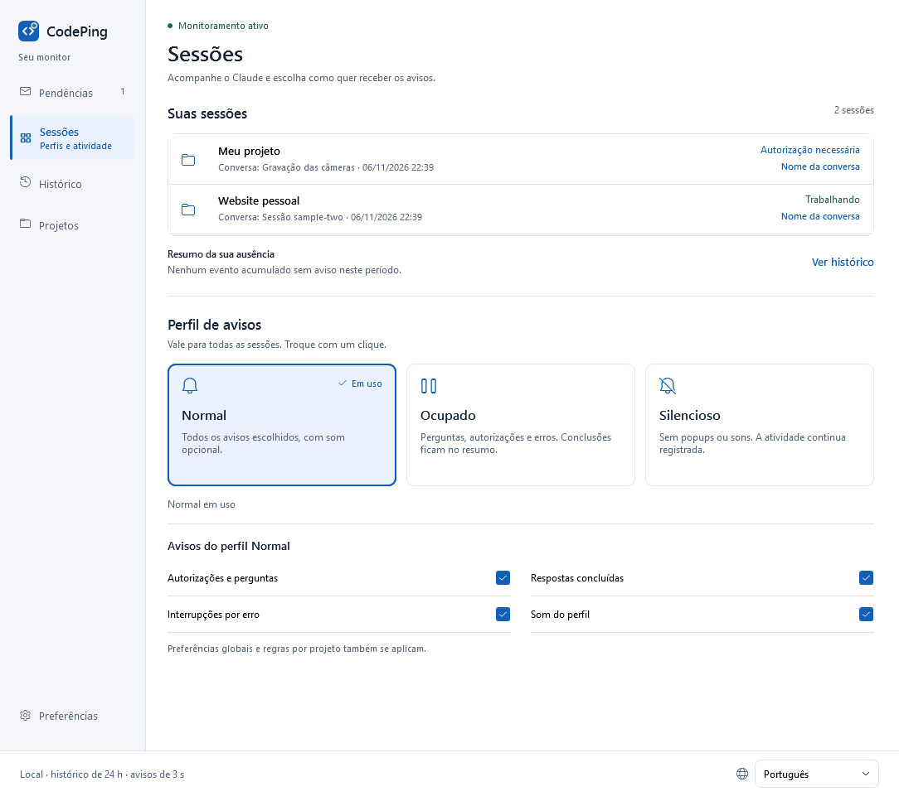
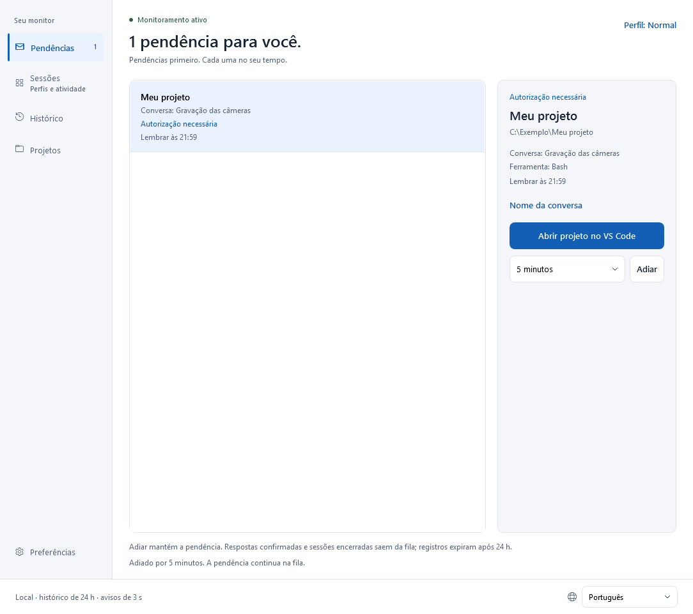
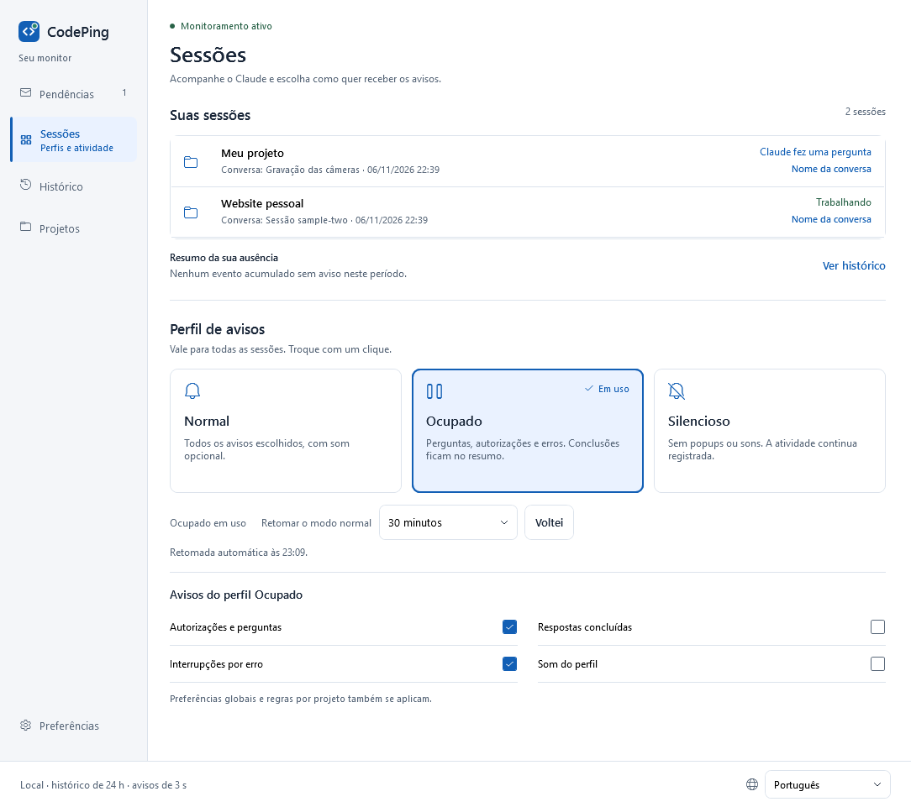
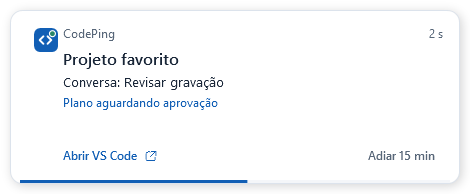
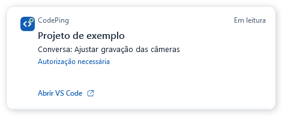
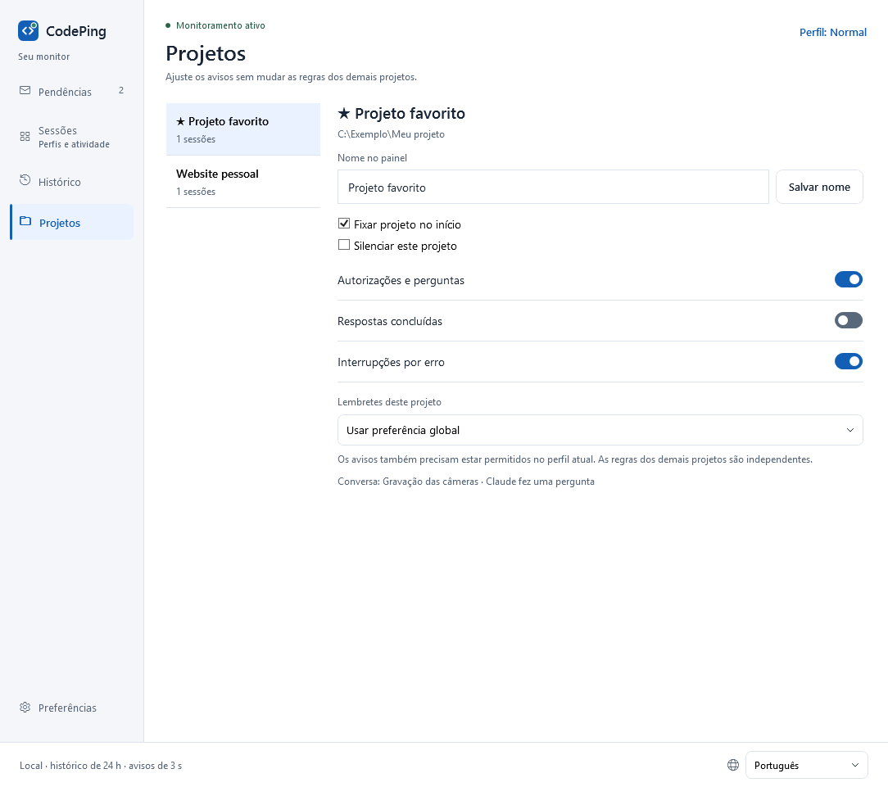
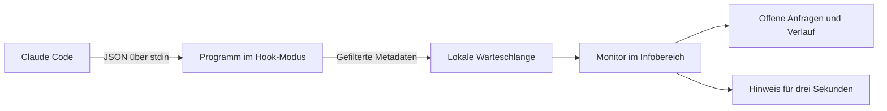

# CodePing

[English](README.md) · [Português](README.pt-BR.md) · [Español](README.es.md) · **Deutsch** · [Français](README.fr.md) · [简体中文](README.zh-Hans.md)


**Ein kurzer Hinweis, wenn Claude Code Sie braucht. Eine Warteschlange für Ihre Rückkehr.**

Lokale Anwendung für **Windows 10/11 x64**, entwickelt mit C# / .NET 10 und WPF. Sie verfolgt lokale Claude-Code-Sitzungen, auch innerhalb von VS Code, und informiert über Fragen, Genehmigungen, abgeschlossene Antworten und Fehler. Der Hinweis zählt **drei Sekunden** herunter und fordert keinen Tastaturfokus an. Solange sich der Mauszeiger darüber befindet, bleibt er zum Lesen sichtbar; wird der Mauszeiger nach Ablauf der Zeit entfernt, schließt er sofort.

**Version 1.6.0 · helles Design · sechs Sprachen.** Der Markenname lautet in allen sechs Sprachen CodePing. Siehe [Versionsverlauf](CHANGELOG.md) und [freigegebene Oberflächengestaltung](design/NAVEGACAO.md).



*Aufnahmen der tatsächlichen Anwendung auf Portugiesisch mit fiktiven Testdaten. Die Oberfläche bietet die sechs oben genannten Sprachen.*

## Funktionen

| Funktion | Möglichkeiten |
| --- | --- |
| **Mehrere Projekte und Gespräche** | Gleichzeitige Sitzungen verfolgen, nach Projekt und Gespräch gekennzeichnet. |
| **Hinweise zu Aktionen und Abschlüssen** | Hinweise auf Fragen, Genehmigungen, Pläne zur Freigabe, Eingabeanforderungen, abgeschlossene Antworten und Fehler erhalten. |
| **Kurzer Hinweis mit Lesemodus per Maus** | Ein Popup drei Sekunden lang sehen, ohne den Fokus zu verlieren; es durch Darüberhalten des Mauszeigers geöffnet lassen. |
| **Ton und Popup unabhängig** | Globale Hinweiskanäle wählen und den Ton je Profil anpassen. |
| **Dauerhaft gespeicherte Warteschlange** | Noch offene Anfragen auch nach einem Neustart des Programms einsehen. |
| **Einzeln zurückstellen** | Jede Anfrage um 5, 15 oder 30 Minuten zurückstellen; im Popup um 15 Minuten. |
| **Begrenzte Erinnerungen** | Progressive Wiederholung, ein festes Intervall oder keine automatische Wiederholung verwenden. |
| **Sichtbare Profile** | Zwischen Normal, Beschäftigt und Lautlos wechseln, wobei die Optionen jedes Profils stets geöffnet bleiben. |
| **Rückkehr und Zusammenfassung** | Die Rückkehr zu Normal planen oder Zurück verwenden und nachsehen, was während Ihrer Abwesenheit passiert ist. |
| **Erkennbare Namen** | Den von Claude übermittelten benutzerdefinierten Titel verwenden oder jedem Gespräch und Projekt einen lokalen Alias geben. |
| **Regeln je Projekt** | Projekte anheften, stummschalten, Kategorien wählen und Erinnerungen anpassen, ohne andere Projekte zu ändern. |
| **Lokaler Verlauf** | Bestätigte Antworten, Abschlüsse, Fehler und Sitzungsenden mit einer Aufbewahrungsdauer von 24 Stunden und bis zu 500 Aktivitäten einsehen. |
| **Rückkehr zum Editor** | Den Projektordner in VS Code öffnen oder versuchen, das vorhandene Fenster wiederherzustellen. |
| **Windows-Infobereich** | Den Monitor im Hintergrund laufen lassen, das Dashboard öffnen, Hinweise testen und vorübergehend stummschalten. |
| **Sechs Sprachen** | Sofort zwischen Portugiesisch, Englisch, Spanisch, Deutsch, Französisch und vereinfachtem Chinesisch wechseln. |
| **Diagnose** | Integration, Programmdatei, Schreibzugriff auf die Warteschlange und Zeitpunkt des letzten empfangenen Ereignisses prüfen. |
| **Lokal und barrierearm** | Tastaturnavigation, sichtbaren Fokus und Anpassungen für hohen Kontrast nutzen, ohne Daten an Netzwerkdienste zu senden. |
| **Marke und kompatible Aktualisierung** | Das CodePing-Logo verwenden, bisherige Einstellungen beibehalten und durch die Paketierung nur die aktuelle lokale Release behalten. |

## Welche Situationen Hinweise auslösen

| Situation | Hinweis oder Verhalten |
| --- | --- |
| Claude bittet um Genehmigung für ein Werkzeug | **Genehmigung erforderlich**. |
| Claude verwendet AskUserQuestion | **Claude hat eine Frage**. |
| Claude übermittelt mit ExitPlanMode einen Plan zur Freigabe | **Plan wartet auf Freigabe**. |
| Eine Integration fordert eine Antwort an, auch über Eingabe-/MCP-Benachrichtigungen | **Antwort erforderlich**, wenn das entsprechende Ereignis empfangen wird. |
| Claude beendet eine Antwort | **Antwort abgeschlossen**. Das belegt nicht, dass die gesamte Aufgabe abgeschlossen ist. |
| Claude sendet StopFailure | **Claude wurde wegen eines Fehlers angehalten**. |
| Eine Sitzung beginnt, ein neuer Prompt wird gesendet oder übliche Werkzeuge werden verwendet | Aktualisiert den Sitzungsstatus; erzeugt nicht für jede Aktivität ein Popup. |
| Eine Sitzung endet | Entfernt ihre offenen Anfragen und vermerkt das Ende im Verlauf. |

Hinweise hängen von den globalen Einstellungen, dem Profil und den Projektregeln ab. CodePing verfolgt Ereignisse von Claude Code; die Inaktivität von VS Code allein löst keinen Hinweis aus.

## Herunterladen und ausführen

1. Öffnen Sie die [neueste Version](https://github.com/victorcqueiroz/CodePing/releases/latest) und laden Sie `CodePing-1.6.0-win-x64.zip` herunter.
2. Entpacken Sie **alle Dateien** in einen dauerhaften Ordner und öffnen Sie `CodePing.exe`.
3. Öffnen Sie **Einstellungen → Integration aktivieren**. Ist die Integration bereits eingerichtet, heißt die Aktion **Integration aktualisieren**.
4. Öffnen Sie ein neues Claude-Code-Gespräch in VS Code, um die Konfiguration zu laden.
5. Verwenden Sie **Einstellungen → Hinweis testen**. Sie können das Dashboard schließen und die Anwendung im Infobereich laufen lassen.

Das Paket enthält die .NET-Laufzeit; zur Nutzung muss das SDK nicht installiert werden. Erforderlich ist lokales Claude Code mit Befehls-Hooks, die `command`, `args` und `onFailure` unterstützen (die Integration wurde ursprünglich mit Claude Code 2.1.312 geprüft). Die Schaltfläche zur Rückkehr benötigt VS Code. Die Programmdatei besitzt keine kommerzielle digitale Signatur.

Mit der Datei `SHA256SUMS.txt` der Veröffentlichung lässt sich die ZIP-Datei prüfen:

```powershell
Get-FileHash .\CodePing-1.6.0-win-x64.zip -Algorithm SHA256
```

Bewahren Sie die Dateien des Pakets zusammen auf. Die Hooks speichern den Pfad der Programmdatei; wenn Sie den Ordner wechseln, aktualisieren Sie die Integration am neuen Speicherort.

### Hinweise und Betrieb im Infobereich

Unter **Einstellungen** lassen sich Ton und Popup getrennt ein- oder ausschalten. Der Ton hängt außerdem von der Profiloption ab; Lautlos blockiert beides. Das Abschalten von Hinweisen beendet weder die Ereigniserfassung noch löscht es offene Anfragen.

Das Popup erscheint unten rechts im Arbeitsbereich des Monitors, auf dem sich der Mauszeiger befindet, bleibt über anderen Fenstern und fordert keinen Tastaturfokus an. Es zeigt Projekt, Gespräch, Status und Countdown. Mit **VS Code öffnen** kehren Sie zum Projekt zurück; bei offenen Anfragen steht außerdem **15 Min. später** zur Verfügung. Über das Kontextmenü des Hinweises können Sie für fünf Minuten stummschalten.

Die drei Sekunden laufen weiter, während sich der Mauszeiger über dem Hinweis befindet. Läuft die Zeit beim Lesen ab, zeigt er **Lesemodus** und bleibt geöffnet. Wird der Mauszeiger nach Ablauf entfernt, schließt er sofort; verlassen Sie den Hinweis früher, läuft nur die verbleibende Zeit weiter.

Wenn Sie das Dashboard schließen oder minimieren, wird es in den Infobereich abgelegt und der Monitor läuft weiter. Öffnen Sie es mit einem Doppelklick auf das Symbol erneut. Über das Menü im Infobereich können Sie das Dashboard öffnen, einen Hinweis testen, für fünf Minuten stummschalten, zu Normal zurückkehren, die Integration deaktivieren und die Anwendung beenden. Ein erneuter Start der Programmdatei verwendet die vorhandene Instanz.

Wenn die Integration aktiv ist, kann das nächste Claude-Ereignis den Monitor nach **Beenden** erneut starten. Dies entspricht keinem Autostart-Eintrag für die Windows-Anmeldung.

## Marke und Kompatibilität

CodePing ist der neue Name des früheren Claude Alert / Claude Alerta. Das Logo kombiniert ein Codesymbol mit einem Benachrichtigungspunkt; Blau passt zum hellen Design, Grün kennzeichnet den Ping.

Das Paket enthält **CodePing.exe** als Hauptprogrammdatei. `ClaudeAlerta.exe` ist eine Kopie des Apphosts **derselben Version**, damit Verknüpfungen und Hooks, die den alten Pfad bereits geladen haben, weiter funktionieren. Beide verwenden denselben Monitor und dieselben Daten, ohne zwei Instanzen zu starten. Aktualisieren Sie die Integration, um den neuen Namen zu verwenden.

Die Daten bleiben unter `%LOCALAPPDATA%\ClaudeAlerta`; Einstellungen, Sprachen, Profile, Aliasse, offene Anfragen und Verlauf bleiben erhalten. Auf dem Entwicklungsrechner bleibt der Installationsordner `release/ClaudeAlerta`; die Hauptdatei heißt nun `CodePing.exe`. Die offizielle Repository-Adresse lautet [victorcqueiroz/CodePing](https://github.com/victorcqueiroz/CodePing).

Die Markendateien liegen unter [Assets](Assets/README.md): bearbeitbares SVG, transparentes PNG und ICO mit neun Größen. Um PNGs und ICO unter Windows neu zu erzeugen, verwenden Sie `scripts/brand-assets.ps1`.

## Seitennavigation

Das Dashboard öffnet sich unter **Sitzungen**. Ein einziges Menü links bietet Zugang zu fünf Bereichen:

| Bereich | Inhalt |
| --- | --- |
| **Offen** | Warteschlange mit Anfragen, Kontext und individuellem Zurückstellen. Die Zahl im Menü zeigt, wie viele Anfragen noch auf eine Aktion warten. |
| **Sitzungen** | Alle verfolgten Sitzungen, Zusammenfassung der Abwesenheit und Hinweisprofile. |
| **Verlauf** | Bestätigte Antworten, abgeschlossene Antworten, Fehler und Sitzungsenden der letzten 24 Stunden. |
| **Projekte** | Aliasse, Anheften, Stummschalten und individuelle Regeln. |
| **Einstellungen** | Ton, Popup, Erinnerungen, Hinweistest und Integrationsdiagnose. |

Die Bedienelemente bieten sichtbaren Fokus und native Semantik für die Tastaturnavigation. In kleineren Fenstern lassen sich Sitzungen und Einstellungen vertikal scrollen. Lange Sitzungslisten haben eine begrenzte Höhe, damit die Profile zugänglich bleiben.

## Offen: Wo Ihre Aktion noch aussteht

Jede Anfrage hat eine eigene Zeile mit Projekt, Gesprächsname und Werkzeug, sofern verfügbar. Parallele Fragen innerhalb derselben Sitzung bleiben getrennt.



- **Erinnerung zurückstellen:** Wählen Sie 5, 15 oder 30 Minuten für die ausgewählte Anfrage. Der Hinweis bietet außerdem **15 Min. später**.
- **Projekt in VS Code öffnen:** Versucht, das zum Projekt gehörende Fenster wiederherzustellen oder den Ordner zu öffnen. Wählt kein bestimmtes Gespräch aus.

Den Hinweis zu schließen, den Editor zu öffnen oder eine Anfrage zurückzustellen **beantwortet Claude nicht und erledigt die offene Anfrage nicht**. Eine passende Bestätigung entfernt die Anfrage aus der Warteschlange. Das Beenden der Sitzung entfernt ebenfalls ihre offenen Anfragen und vermerkt das Ende. Ist die Zuordnung zwischen parallelen Werkzeugaufrufen unklar, behält die Anwendung die Anfrage bei, damit sie nicht versehentlich ausgeblendet wird.

Offene Anfragen und Zurückstellungen bleiben nach einem Neustart erhalten. Wiederhergestellte Zustände zeigen **Wiederhergestellt · neues Ereignis ausstehend**, da der zuletzt gespeicherte Status nicht belegt, dass die Sitzung weiterhin aktiv ist. Einträge werden 24 Stunden aufbewahrt; der Verlauf speichert bis zu 500 Aktivitäten. Diese Frist gilt auch für alte Anfragen einer noch geöffneten Sitzung.

Die frühere Schaltfläche **Gesehen** wurde durch ausdrückliches Zurückstellen ersetzt, damit eine noch unbeantwortete Anfrage ihre Erinnerungen nicht auf unbestimmte Zeit verliert.

## Sitzungen: Profile und Aktivität

**Ihre Sitzungen** steht an erster Stelle und umfasst sowohl arbeitende Sitzungen als auch solche, die auf eine Antwort warten. Direkt darunter stehen die drei Karten für das **Hinweisprofil**. Klicken Sie auf eine beliebige Stelle der Karte, um sie auszuwählen; das aktive Profil wird hervorgehoben und mit **Aktiv** gekennzeichnet.

Die Optionen unter **Hinweise für …** bleiben immer geöffnet und ändern sich sofort mit der Auswahl. Zum Anpassen von Genehmigungen/Fragen, Abschlüssen, Fehlern und Ton gibt es weder ein Menü noch einen ausklappbaren Bereich.



| Profil | Standardverhalten |
| --- | --- |
| **Normal** | Erlaubt Fragen, Genehmigungen, Abschlüsse und Fehler. |
| **Beschäftigt** | Erlaubt Fragen, Genehmigungen und Fehler; speichert Abschlüsse ohne Popup und schaltet den Profilton aus. |
| **Lautlos** | Blockiert alle Popups und Töne; empfängt weiterhin Ereignisse und speichert die Aktivität. |

In Normal und Beschäftigt können Sie die erlaubten Kategorien und den Profilton wählen. Der Ton muss auch in den globalen Einstellungen eingeschaltet sein. Lautlos blockiert Hinweise immer, selbst wenn ein Projekt so eingestellt ist, dass sie erlaubt sind.

In Beschäftigt oder Lautlos wählen Sie die Rückkehr **Wenn ich zurück bin**, nach **15 Minuten**, **30 Minuten** oder **1 Stunde**. Der Zeitpunkt wird gespeichert und auch nach einem Programmneustart eingehalten. **Zurück** aktiviert Normal im Bereich Sitzungen; dort zeigt die Zusammenfassung abgeschlossene Antworten und Fehler, für die während Ihrer Abwesenheit kein Hinweis erschien. Anfragen bleiben unter Offen. Beim Wechsel zwischen Beschäftigt und Lautlos bleibt dieser Zeitraum erhalten; die automatische Rückkehr öffnet das Dashboard nicht zwangsweise.

In anderen Bereichen führt die Verknüpfung **Profil: …** direkt zu den Karten unter Sitzungen. **Verlauf öffnen** zeigt die detaillierte Aktivität.

Im Menü des Infobereichs aktiviert **Für 5 Minuten stummschalten** das Profil Lautlos mit automatischer Rückkehr. Das Dashboard lässt sich mit einem Doppelklick auf das Symbol öffnen.

### Begrenzte Erinnerungen

Wählen Sie unter **Einstellungen** die globale Regel:

- **Progressiv: 2, 5 und 15 Minuten:** Die erste Erinnerung folgt nach 2 Minuten, weitere nach Intervallen von 5 und 15 Minuten.
- **Festes Intervall:** 30 Sekunden, 1 Minute oder 2 Minuten; die Optionen der vorherigen Version bleiben erhalten.
- **Keine Erinnerungen:** Schaltet automatische Wiederholungen aus.

Es gibt **bis zu drei zusätzliche Erinnerungen je Anfrage**. Zurückstellen setzt diese Grenze zurück und plant die nächste Erinnerung für den gewählten Zeitpunkt. Auch bei abgeschalteten automatischen Wiederholungen plant ausdrückliches Zurückstellen eine einmalige Erinnerung. Profil, Projektregeln und Popup-/Toneinstellungen werden weiterhin berücksichtigt. Erinnerungen verschiedener Anfragen erscheinen nicht gleichzeitig; der Monitor hält zwischen diesen Erinnerungen mindestens zehn Sekunden Abstand.

Abgeschlossene Antworten und Fehler erhalten, sofern erlaubt, einen ersten Hinweis ohne automatische Wiederholungen. Die Popup-Zeit bleibt bei drei Sekunden. Befindet sich der Mauszeiger beim Ablauf über dem Hinweis, bleibt er sichtbar und zeigt **Lesemodus**. Wird der Mauszeiger danach entfernt, schließt er sofort. Vorheriges Betreten oder Verlassen hält den Countdown weder an noch startet es ihn neu.





## Projekt und Gespräch erkennen

Der Hinweis hebt **das Projekt** hervor, zeigt **das Gespräch** in einer eigenen Zeile und nennt den Status: abgeschlossene Antwort, Genehmigung, Frage oder Fehler. Er schließt nach drei Sekunden automatisch, berücksichtigt dabei den Mauszeiger zum Lesen und fordert keinen Fokus an.

Die Benennung folgt dieser Reihenfolge:

1. **Lokaler Alias**, festgelegt unter **Gesprächsname**.
2. **Benutzerdefinierter Claude-Titel**, sofern über die Integration empfangen.
3. **Kurze Sitzungs-ID**, wenn kein Name verfügbar ist.

Unter **Sitzungen** bietet jede Zeile **Gesprächsname** an. Unter **Offen** und **Verlauf** befindet sich dieselbe Aktion in den Details rechts. Der Editor zeigt Projekt, empfangenen Titel und vollständige ID. Speichern Sie einen Alias oder lassen Sie das Feld leer, um zum Titel/zur ID zurückzukehren. Der Alias gilt nur für diese Sitzung, auch wenn mehrere Gespräche denselben Ordner verwenden oder gleich heißen; er benennt das Gespräch in Claude Code nicht um.

Die Bezeichnung erscheint auch in den Projektlisten. Namen können bis zu 160 Unicode-Zeichen enthalten und werden auf eine Zeile normalisiert. Lange Namen werden in der Anzeige gekürzt; halten Sie den Mauszeiger darüber, um in Listen und Hinweisen den vollständigen Text zu lesen.

Die Erfassung verwendet das optionale Feld `session_title` von [SessionStart](https://code.claude.com/docs/en/hooks#sessionstart-input) und [UserPromptSubmit](https://code.claude.com/docs/en/hooks#userpromptsubmit-input). Sie hängt davon ab, ob die installierte Claude-Code-Version dieses Feld bereitstellt. Ein benutzerdefinierter Name lässt sich in Claude mit `/rename` festlegen; die Integration erhält ihn beim nächsten kompatiblen Ereignis. **Automatisch erzeugte Titel werden in diesem Feld nicht übermittelt.** Die Anwendung liest weder das Gespräch noch das Transkript, um sie zu ermitteln. Ereignisse ohne Titel behalten den zuletzt empfangenen Titel bei; ein ausdrücklich leerer Titel löscht ihn.

Empfangene Titel bleiben im Status und in den Aktivitäten erhalten, auch nach Sitzungsende, entsprechend der Aufbewahrungsdauer von 24 Stunden. Gewählte Aliasse bleiben bis zu ihrer Entfernung in den Einstellungen. Dateien früherer Versionen funktionieren weiterhin ohne manuelle Migration. **VS Code öffnen** öffnet weiterhin das Projekt, ohne ein bestimmtes Gespräch auszuwählen.

## Projekte: Unabhängige Regeln



Projekte erscheinen, sobald ihre Ereignisse eintreffen. Sie können:

- einen Alias vergeben, der nur im Dashboard und in Hinweisen erscheint, ohne den Ordner umzubenennen;
- häufig verwendete Projekte oben anheften;
- ein Projekt stummschalten, ohne andere zu beeinflussen;
- Genehmigungen/Fragen, Abschlüsse und Fehler erlauben oder blockieren;
- das globale Erinnerungsintervall übernehmen oder ein anderes für dieses Projekt wählen;
- die Gesprächsnamen und bekannten Sitzungszustände einsehen.

Projektregeln **schränken** das aktuelle Profil **ein**: Ein Hinweis muss in beiden erlaubt sein. Ordner werden unabhängig von Groß-/Kleinschreibung und abschließendem Pfadtrenner verglichen. Gleiche Namen in verschiedenen Ordnern bleiben unterschiedliche Projekte.

## Integration prüfen

Unter **Einstellungen** prüft **Integration prüfen** die Programmdatei, die erwarteten Handler in der Benutzerkonfiguration und den Schreibzugriff auf die lokale Warteschlange. Derselbe Bereich zeigt den Zeitpunkt des **letzten empfangenen Ereignisses** gesondert an.

Eine gültige Konfiguration belegt nicht, dass neue Ereignisse zugestellt werden. Der gesamte Ablauf ist erst bestätigt, wenn ein echtes Claude-Ereignis eintrifft. Ausbleibende Ereignisse werden nicht als Hängenbleiben oder Verbindungsabbruch behandelt; eine lange Antwort kann einige Zeit ohne Ereignisse bleiben. Richtlinien, Projekteinstellungen und `disableAllHooks` können die Ausführung der Hooks beeinflussen.

## Sprachen

Unten rechts bietet eine dezente Auswahl **Português, English, Español, Deutsch, Français und 简体中文** an. Der Wechsel erfolgt sofort, umfasst die gesamte Navigation, Karten, Profiloptionen, Hinweise und den Infobereich und wird für den nächsten Start gespeichert. Die Sprache ändert weder den Status offener Anfragen noch startet sie die Frist eines geöffneten Hinweises neu.

Portugiesisch ist die Standardsprache. Einstellungen aus Version 1.2.0 behalten Sprache, Ton, Popup und Erinnerungsintervall bei. Neue Installationen beginnen mit progressiven Erinnerungen. Die Sprachkataloge sind in das Programm eingebettet und verwenden keine Übersetzung über das Netzwerk.

## Lokale Daten und Datenschutz

Das Programm verwendet die [offiziellen Claude-Code-Hooks](https://code.claude.com/docs/en/hooks). Es versucht weder, Bildschirmbilder auszuwerten, noch aus der CPU-Auslastung auf Aktivität zu schließen.



Dieselbe Programmdatei nimmt im Hook-Modus Ereignisse schnell entgegen und betreibt den Monitor, der die Warteschlange alle 500 ms abfragt. Temporäre Ereignisse werden nach Verarbeitung und Speicherung gelöscht; Ereignisse, die älter als zehn Minuten sind, werden verworfen. Identische kürzlich empfangene Ereignisse werden dedupliziert, auch nach einem Neustart.

Unter `%LOCALAPPDATA%\ClaudeAlerta`:

| Datei/Ordner | Inhalt |
| --- | --- |
| `preferences.json` | Sprache, Ton, Popup, Profil, Rückkehrzeitpunkt, Projekt-/Gesprächsaliasse und Regeln je Projekt. |
| `activity.json` | Sitzungen, benutzerdefinierte Titel, Anfragen, Zurückstellungen, Werkzeug-IDs, Verlauf und Zeitpunkt des letzten Ereignisses. |
| `inbox/` | Temporäre Ereignismetadaten. |

Gespeichert werden ausschließlich Sitzungs-/Werkzeug-IDs, Projektordner, Ereignis-/Werkzeugnamen, Benachrichtigungstyp, empfangene benutzerdefinierte Titel und Zeitpunkte sowie daraus abgeleitete Zustände und gewählte Einstellungen. **Prompts, Antworten, Befehle, Dateiinhalte, Benachrichtigungstexte und Transkripte werden vor dem Schreiben verworfen.** Die Anwendung erfasst den Bildschirm nicht, genehmigt keine Vorgänge und stellt keine Netzwerkanfragen. Testaufnahmen rendern nur ihre eigenen Fenster.

Das Speichern erfolgt durch atomaren Dateiaustausch. Kann eine Datei nicht wiederhergestellt werden, meldet das Dashboard das Problem; vor dem Ersetzen bleibt eine Kopie `*.invalid-*.bak` erhalten. Diese Wiederherstellungssicherungen unterliegen nicht dem automatischen Ablauf nach 24 Stunden. Scheitert das Speichern der Aktivität, bleibt das Ereignis für einen erneuten Versuch in der Warteschlange und das Dashboard meldet den Fehler.

Die Integration ändert `~/.claude/settings.json`, behält andere Einstellungen und Hooks bei und erstellt vor der Änderung eine Kopie `settings.json.claude-alerta-*.bak`. Zum Deaktivieren wählen Sie im Infobereich **Integration deaktivieren** und anschließend **Beenden**. Wenn Sie nur beenden, kann das nächste Ereignis den Monitor erneut starten.

## Verfügbare Befehle

Führen Sie die Befehle im entpackten Anwendungsordner aus:

| Befehl | Aktion |
| --- | --- |
| `.\CodePing.exe` | Öffnet das Dashboard oder fordert die bereits laufende Instanz zum Öffnen auf. |
| `.\CodePing.exe --tray` | Startet den Monitor im Infobereich. |
| `.\CodePing.exe --install-hooks` | Installiert oder aktualisiert die Integration, behält andere Einstellungen bei und erstellt eine Sicherung, falls bereits eine Datei vorhanden ist. |
| `.\CodePing.exe --remove-hooks` | Entfernt nur die zur Anwendung gehörenden Handler. |
| `.\CodePing.exe --shutdown` | Fordert den laufenden Monitor zum Beenden auf. |

Die Testskripte verwenden Diagnosemodi mit isoliertem Speicher; zur Überwachung von Claude Code sind sie nicht erforderlich.

## Einschränkungen

- Überwacht **lokale** Sitzungen des Windows-Kontos, auch im Terminal; die Nutzung ist nicht auf die VS-Code-Erweiterung beschränkt.
- WSL, SSH, Container und Cloud-Sitzungen benötigen eine zusätzliche Brücke, die dieses Projekt nicht implementiert. Codex wird nicht überwacht.
- `Stop` bedeutet das Ende einer Antwort, nicht den vollständigen Abschluss der Aufgabe. `idle_prompt` ist eine Erinnerung bei Inaktivität und kein Beleg für eine festgefahrene Verarbeitung.
- `PermissionRequest` liefert keine `tool_use_id`. Lässt sich eine parallele Genehmigungsanfrage nicht sicher zuordnen, bleibt sie bis zu einer eindeutigen Bestätigung, dem Sitzungsende oder dem Ablauf offen.
- Verlorene oder in falscher Reihenfolge eintreffende Ereignisse können einen Status unbestätigt lassen. Prüfen Sie das Gespräch in Claude; der Monitor trifft keine Entscheidungen für Sie.
- Die Rückkehr zu VS Code erkennt nicht das genaue Gespräch. Spiele im exklusiven Vollbildmodus können den Hinweis verdecken.
- Es wird jeweils ein Popup angezeigt; ein neuer Hinweis kann den vorherigen ersetzen, auch beim Lesen mit dem Mauszeiger. Anfragen bleiben in der Warteschlange und Abschluss-/Fehlerereignisse im Verlauf verfügbar.
- Die Bereinigung erfolgt, während der Monitor geöffnet ist oder wenn er erneut startet; bei geschlossener Anwendung läuft kein Bereinigungsdienst.

## Kompilieren, testen und paketieren

Erfordert das [.NET 10 SDK](https://dotnet.microsoft.com/download/dotnet/10.0), Windows x64 und PowerShell 7:

```powershell
git clone https://github.com/victorcqueiroz/CodePing.git
cd CodePing
.\scripts\build.ps1
.\scripts\test.ps1 -SkipBuild -Ui
.\scripts\package.ps1 -SkipBuild
```

Die Veröffentlichung liegt unter `artifacts/publish/win-x64/`; ZIP-Datei und SHA-256 liegen unter `artifacts/releases/1.6.0/`. Um ein anderes lokales SDK zu verwenden, übergeben Sie `-Dotnet C:\caminho\dotnet.exe` an die Build-, Test- oder Paketierungsskripte.

### Nur die neueste lokale Release behalten

Die Paketierung behält nur das Paket der aktuellen Version unter `artifacts/releases/`. ZIP-Dateien früherer Versionen werden erst entfernt, nachdem das neue Paket und sein SHA-256 verfügbar und geprüft sind. Ordner mit neueren Versionen oder unbekanntem Inhalt bleiben erhalten.

Um auch alte Distributionen unter `release/` und `artifacts/` eines bereits vorhandenen Arbeitsordners zu bereinigen:

```powershell
.\scripts\clean-releases.ps1 -LegacyRoot 'C:\caminho\da\pasta-de-trabalho' -WhatIf
.\scripts\clean-releases.ps1 -LegacyRoot 'C:\caminho\da\pasta-de-trabalho'
```

Die Bereinigung erfordert ein gültiges aktuelles Paket. Sie entfernt nur alte Ordner, die als CodePing oder Claude Alert erkannt werden, prüft die Pfade und weist Links/Junctions zurück. Die Installation ohne Suffix `release/ClaudeAlerta`, persönliche Daten, andere Projekte und der Verlauf auf GitHub bleiben erhalten. Lokale Aktualisierungen sollen den einzigen Installationsordner ersetzen und alte Binärdateien nach der Prüfung verwerfen, ohne Sicherungen früherer Releases aufzubewahren.

Führen Sie nach dem Kompilieren `scripts/test-cleanup.ps1` aus, um diese Aufbewahrungsregel in isolierten Ordnern zu testen, einschließlich des Erhalts anderer Projekte und der Einbindung in die Paketierung.

Um nur die Programmdatei über das SDK zu kompilieren:

```powershell
dotnet publish .\ClaudeAlerta.csproj -c Release -r win-x64 --self-contained true -o .\artifacts\publish\win-x64
```

Die Tests verwenden isolierten Speicher unter `artifacts/tests/` und erhalten die persönlichen Claude-Einstellungen. `-Ui` erfordert eine Windows-Sitzung mit verfügbarem Desktop und kann kurz Fenster anzeigen. Ergebnisse, Nachweise und Grenzen stehen in [VALIDACAO.md](VALIDACAO.md).

Verwenden Sie vorzugsweise `scripts/build.ps1`, um eine Distribution vorzubereiten: Es erstellt eine saubere Veröffentlichung, fügt Dokumentation und Markendateien hinzu und erzeugt den Kompatibilitäts-Apphost `ClaudeAlerta.exe`. Der direkte SDK-Aufruf führt diese zusätzlichen Schritte nicht aus. Reine Dokumentationsänderungen erfordern weder eine neue Version der Programmdatei noch das Ersetzen der Prüfsummen einer bereits veröffentlichten Release.

## Dokumentation in anderen Sprachen

Die sechs READMEs behandeln dieselben Funktionen, Anleitungen und Einschränkungen. Verwenden Sie die Sprachlinks oben. Versionsverlauf, Validierungsbericht, Markenleitfaden und verlinkte Designdokumente bleiben auf Portugiesisch.

## Struktur

```text
Program.cs               Initialisierung, Infobereich und Hook-Eingang
Core.cs                  Speicherung, Filterung und Installation der Hooks
MonitorModel.cs          Unabhängige Anfragen, Verlauf und dauerhafte Speicherung
Preferences.cs           Profile, Projektregeln und Erinnerungsrichtlinie
Dashboard.xaml/.cs       Seitennavigation, Sitzungen, Profile und Diagnose
AlertCard.xaml(.cs)       Drei-Sekunden-Hinweis und Lesen mit dem Mauszeiger
ConversationEditor.*     Editor für den lokalen Gesprächsalias
ConversationNames.cs     Normalisierung und Begrenzung der Namen
ClaroTheme.xaml          Helles Design und gemeinsame Stile
Assets/                  SVG-/XAML-Logo, PNGs, ICO und Markenleitfaden
Localization.cs          Sprachumschaltung und Fallback
Locales/                 Sechs eingebettete Sprachkataloge
SelfTest.cs / UiCheck.cs  Isolierte Tests des Monitors und der Oberfläche
scripts/                 Kompilierung, Tests und versioniertes Paket
docs/images/             Demonstrationsaufnahmen
```

Es sind keine Drittanbieterpakete deklariert. Das Logo ist eine eigene Ressource des Projekts; die übrigen Glyphen und Schriftarten verwenden Windows-Systemressourcen.
