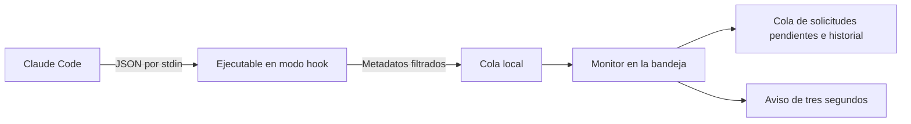

# CodePing

[English](README.md) · [Português](README.pt-BR.md) · **Español** · [Deutsch](README.de.md) · [Français](README.fr.md) · [简体中文](README.zh-Hans.md)


**Un breve aviso cuando Claude Code te necesite. Una cola para cuando puedas volver.**

Aplicación local para **Windows 10/11 x64**, desarrollada en C# / .NET 10 y WPF. Sigue las sesiones locales de Claude Code, incluso dentro de VS Code, y avisa de preguntas, autorizaciones, respuestas completadas y errores. El aviso cuenta **tres segundos** y no solicita el foco de escritura. Al mantener el ratón encima, permanece visible para leerlo; al retirarlo una vez transcurrido el plazo, se cierra inmediatamente.

**Versión 1.6.0 · tema Claro · seis idiomas.** La marca es CodePing en los seis idiomas. Consulta el [historial de versiones](CHANGELOG.md) y la [organización visual aprobada](design/NAVEGACAO.md).


*Capturas de la aplicación real en portugués, con datos ficticios de prueba. La interfaz ofrece los seis idiomas indicados arriba.*

## Funcionalidades

| Función | Qué puedes hacer |
| --- | --- |
| **Varios proyectos y conversaciones** | Seguir sesiones simultáneas, identificadas por proyecto y conversación. |
| **Avisos de acción y finalización** | Recibir avisos de preguntas, autorizaciones, planes pendientes de aprobación, solicitudes de entrada, respuestas completadas y errores. |
| **Aviso breve con lectura mediante el ratón** | Ver un aviso emergente de tres segundos sin perder el foco; mantenerlo abierto al pasar el ratón por encima. |
| **Sonido y aviso emergente independientes** | Elegir los canales globales de aviso y personalizar el sonido de cada perfil. |
| **Cola persistente** | Consultar solicitudes aún pendientes, incluso después de reiniciar el programa. |
| **Aplazamiento individual** | Posponer cada solicitud 5, 15 o 30 minutos; desde el aviso emergente, posponerla 15 minutos. |
| **Recordatorios limitados** | Usar repetición progresiva, un intervalo fijo o ninguna repetición automática. |
| **Perfiles visibles** | Alternar entre Normal, Ocupado y Silencioso, con las opciones de cada perfil siempre abiertas. |
| **Reanudación y resumen** | Programar la vuelta a Normal o usar Ya volví y consultar lo ocurrido durante tu ausencia. |
| **Nombres reconocibles** | Usar el título personalizado recibido de Claude o elegir un alias local para cada conversación y proyecto. |
| **Reglas por proyecto** | Fijar, silenciar, elegir categorías y ajustar los recordatorios sin modificar los demás proyectos. |
| **Historial local** | Consultar respuestas confirmadas, finalizaciones, errores y cierres, con una retención de 24 horas y hasta 500 actividades. |
| **Vuelta al editor** | Abrir la carpeta del proyecto en VS Code o intentar restaurar su ventana existente. |
| **Bandeja de Windows** | Mantener el monitor en segundo plano, abrir el panel, probar avisos y silenciarlos temporalmente. |
| **Seis idiomas** | Cambiar inmediatamente entre portugués, inglés, español, alemán, francés y chino simplificado. |
| **Diagnóstico** | Comprobar la integración, el ejecutable, la escritura de la cola y la hora del último evento recibido. |
| **Uso local y accesible** | Usar navegación por teclado, foco visible y ajustes de alto contraste, sin enviar datos a servicios de red. |
| **Identidad y actualización compatible** | Usar el logotipo de CodePing, mantener la configuración anterior y conservar únicamente la versión local actual mediante el empaquetado. |

## Qué situaciones generan avisos

| Situación | Aviso o comportamiento |
| --- | --- |
| Claude pide permiso para una herramienta | **Se necesita autorización**. |
| Claude usa AskUserQuestion | **Claude tiene una pregunta**. |
| Claude envía un plan para su aprobación con ExitPlanMode | **Plan pendiente de aprobación**. |
| La integración pide una respuesta, incluso mediante notificaciones de entrada/MCP | **Se necesita una respuesta**, cuando se recibe el evento correspondiente. |
| Claude termina una respuesta | **Respuesta completada**. Esto no demuestra que haya terminado toda la tarea. |
| Claude emite StopFailure | **Claude se detuvo por un error**. |
| La sesión se inicia, envía un nuevo prompt o usa herramientas comunes | Actualiza el estado de la sesión; no genera un aviso emergente por cada actividad. |
| La sesión termina | Retira sus solicitudes pendientes y registra el cierre en el historial. |

Los avisos dependen de las preferencias globales, del perfil y de las reglas del proyecto. CodePing sigue los eventos de Claude Code; la inactividad de VS Code, por sí sola, no genera un aviso.

## Descargar y ejecutar

1. Abre la [versión más reciente](https://github.com/victorcqueiroz/CodePing/releases/latest) y descarga `CodePing-1.6.0-win-x64.zip`.
2. Extrae **todos los archivos** en una carpeta definitiva y abre `CodePing.exe`.
3. Abre **Preferencias → Activar integración**. Si ya está configurada, la acción aparece como **Actualizar integración**.
4. Abre una nueva conversación de Claude Code en VS Code para cargar la configuración.
5. Usa **Preferencias → Probar aviso**. Puedes cerrar el panel y dejarlo en la bandeja.

El paquete incluye el runtime de .NET; no hace falta instalar el SDK para usarlo. Requiere Claude Code local con hooks de comando que acepten `command`, `args` y `onFailure` (integración validada originalmente con Claude Code 2.1.312). El botón de vuelta al editor requiere VS Code. El ejecutable no tiene firma digital comercial.

El archivo `SHA256SUMS.txt` de la publicación permite verificar el ZIP:

```powershell
Get-FileHash .\CodePing-1.6.0-win-x64.zip -Algorithm SHA256
```

Mantén juntos los archivos del paquete. Los hooks guardan la ruta del ejecutable; si lo cambias de carpeta, actualiza la integración desde la nueva ubicación.

### Avisos y funcionamiento en la bandeja

En **Preferencias**, el sonido y el aviso emergente se pueden activar o desactivar por separado. El sonido también depende de la opción del perfil; Silencioso bloquea ambos. Desactivar los avisos no interrumpe la recogida de eventos ni borra las solicitudes pendientes.

El aviso emergente aparece en la esquina inferior derecha del área de trabajo del monitor donde se encuentra el puntero, permanece por encima de otras ventanas y no solicita el foco de escritura. Muestra el proyecto, la conversación, el estado y la cuenta atrás. Usa **Abrir VS Code** para volver al proyecto; las solicitudes pendientes también ofrecen **Posponer 15 min**. El menú contextual del aviso permite silenciar durante cinco minutos.

Los tres segundos siguen transcurriendo con el ratón sobre el aviso. Si el plazo vence durante la lectura, muestra **En lectura** y permanece abierto. Al retirar el ratón después del plazo, se cierra inmediatamente; si lo retiras antes, utiliza solo el tiempo restante.

Cerrar o minimizar el panel lo recoge en la bandeja y mantiene el monitor funcionando. Haz doble clic en el icono para abrirlo de nuevo. El menú de la bandeja permite abrir el panel, probar un aviso, silenciar durante cinco minutos, volver a Normal, desactivar la integración y salir. Una segunda apertura del ejecutable reutiliza la instancia existente.

Si la integración está activa, un siguiente evento de Claude puede iniciar de nuevo el monitor después de **Salir**. Esto no equivale a registrar un inicio automático al iniciar sesión en Windows.

## Marca y compatibilidad

CodePing es el nuevo nombre del antiguo Claude Alert / Claude Alerta. El logotipo combina un símbolo de código con un punto de notificación; el azul acompaña al tema Claro y el verde identifica el ping.

El paquete incluye **CodePing.exe** como ejecutable principal. `ClaudeAlerta.exe` es una copia del apphost **de esta misma versión**, para que sigan funcionando los accesos directos y hooks que ya hayan cargado la ruta antigua. Ambos usan el mismo monitor y los mismos datos, sin iniciar dos instancias. Actualiza la integración para usar el nombre nuevo.

Los datos siguen en `%LOCALAPPDATA%\ClaudeAlerta`, conservando preferencias, idiomas, perfiles, alias, solicitudes pendientes e historial. En la máquina de desarrollo, la carpeta de instalación sigue siendo `release/ClaudeAlerta`; el archivo principal ahora es `CodePing.exe`. La dirección oficial del repositorio es [victorcqueiroz/CodePing](https://github.com/victorcqueiroz/CodePing).

Los archivos de la marca están en [Assets](Assets/README.md): SVG editable, PNG transparente e ICO con nueve tamaños. Para volver a generar los PNG y el ICO en Windows, usa `scripts/brand-assets.ps1`.

## Navegación lateral

El panel se abre en **Sesiones**. Un único menú a la izquierda da acceso a las cinco áreas:

| Área | Contenido |
| --- | --- |
| **Pendientes** | Cola de solicitudes, contexto y aplazamiento individual. El número del menú indica cuántas siguen esperando una acción. |
| **Sesiones** | Todas las sesiones supervisadas, resumen de la ausencia y perfiles de avisos. |
| **Historial** | Respuestas confirmadas, respuestas completadas, errores y cierres de las últimas 24 horas. |
| **Proyectos** | Alias, fijación, silencio y reglas individuales. |
| **Preferencias** | Sonido, aviso emergente, recordatorios, prueba de aviso y diagnóstico de la integración. |

Los controles tienen foco visible y semántica nativa para la navegación por teclado. En ventanas más pequeñas, Sesiones y Preferencias usan desplazamiento vertical. Las listas extensas de sesiones tienen una altura limitada para mantener los perfiles accesibles.

## Pendientes: lo que aún requiere tu atención

Cada solicitud tiene su propia fila, proyecto, nombre de conversación y herramienta, cuando está disponible. Las preguntas paralelas de la misma sesión permanecen separadas.


- **Posponer recordatorio:** elige 5, 15 o 30 minutos para la solicitud seleccionada. El aviso también ofrece **Posponer 15 min**.
- **Abrir proyecto en VS Code:** intenta restaurar la ventana correspondiente al proyecto o abrir su carpeta. No selecciona una conversación específica.

Cerrar el aviso, abrir el editor o posponer **no responde a Claude ni resuelve la solicitud pendiente**. Una confirmación correspondiente retira la solicitud de la cola. Terminar la sesión también retira sus solicitudes pendientes y registra el cierre. Si hay dudas al relacionar herramientas paralelas, la aplicación conserva la solicitud pendiente para evitar ocultarla por error.

Las solicitudes pendientes y los aplazamientos sobreviven al reinicio. Los estados recuperados muestran **Restaurado · esperando otro evento**, ya que el último estado guardado no demuestra que la sesión siga activa. Los registros se conservan durante 24 horas; el historial guarda hasta 500 actividades. Ese plazo también se aplica a las solicitudes antiguas de una sesión que siga abierta.

El antiguo botón **Visto** se sustituyó por el aplazamiento explícito, para que una solicitud aún sin respuesta no pierda sus recordatorios indefinidamente.

## Sesiones: perfiles y actividad

**Tus sesiones** aparece primero e incluye sesiones trabajando y esperando una respuesta. Justo debajo están las tres tarjetas de **Perfil de avisos**. Haz clic en cualquier parte de la tarjeta para seleccionarla; el perfil activo queda resaltado y muestra **En uso**.

Las opciones de **Avisos del perfil…** permanecen siempre abiertas y cambian inmediatamente con la selección. No hay un menú ni un control desplegable para personalizar autorizaciones/preguntas, finalizaciones, errores y sonido.


| Perfil | Comportamiento predeterminado |
| --- | --- |
| **Normal** | Permite preguntas, autorizaciones, finalizaciones y errores. |
| **Ocupado** | Permite preguntas, autorizaciones y errores; guarda las finalizaciones sin aviso emergente y desactiva el sonido del perfil. |
| **Silencioso** | Bloquea todos los avisos emergentes y sonidos; sigue recibiendo eventos y guardando la actividad. |

En Normal y Ocupado puedes elegir las categorías permitidas y el sonido del perfil. El sonido también debe estar activado en las preferencias globales. El modo Silencioso siempre bloquea los avisos, aunque un proyecto esté configurado para permitirlos.

En Ocupado o Silencioso, elige la reanudación **manual**, en **15 minutos**, **30 minutos** o **1 hora**. El plazo queda guardado y se respeta después de reiniciar el programa. **Ya volví** vuelve a Normal en la pantalla Sesiones, donde el resumen indica las respuestas completadas y los errores que no se avisaron durante tu ausencia. Las solicitudes siguen en Pendientes. Alternar entre Ocupado y Silencioso conserva ese período; la reanudación automática no fuerza la apertura del panel.

En otras áreas, el acceso directo **Perfil: …** lleva directamente a las tarjetas de Sesiones. La opción **Ver historial** abre la actividad detallada.

En el menú de la bandeja, **Silenciar durante 5 minutos** aplica Silencioso con vuelta automática. El panel se puede abrir con un doble clic en el icono.

### Recordatorios con límite

En **Preferencias**, elige la política global:

- **Progresivo:** primer recordatorio después de 2 minutos; los siguientes tras intervalos de 5 y 15 minutos.
- **Intervalo fijo:** 30 segundos, 1 minuto o 2 minutos, conservando las opciones de la versión anterior.
- **Sin recordatorios:** desactiva las repeticiones automáticas.

Hay **hasta tres recordatorios adicionales por solicitud**. Posponer reinicia ese límite y programa el siguiente recordatorio para el plazo elegido. Incluso con las repeticiones automáticas desactivadas, un aplazamiento explícito programa un único recordatorio de vuelta. Se siguen respetando el perfil, las reglas del proyecto y las preferencias de aviso emergente/sonido. Las solicitudes diferentes no muestran recordatorios simultáneos; el monitor los separa al menos diez segundos.

Las respuestas completadas y los errores reciben un aviso inicial cuando está permitido, sin repeticiones automáticas. El temporizador del aviso emergente sigue siendo de tres segundos. Si el ratón está sobre el aviso al vencer ese plazo, permanece visible y muestra **En lectura**. Al retirarlo después del plazo, se cierra inmediatamente. Entrar o salir antes no pausa ni reinicia la cuenta atrás.


## Identificar el proyecto y la conversación

El aviso destaca **el proyecto**, muestra **la conversación** en su propia línea e indica el estado: respuesta completada, autorización, pregunta o error. Se cierra automáticamente después de tres segundos, respetando la permanencia del ratón para la lectura, sin solicitar el foco.

La identificación sigue este orden:

1. **Alias local**, definido en **Nombre de la conversación**.
2. **Título personalizado de Claude**, cuando se recibe mediante la integración.
3. **ID corto de la sesión**, cuando no hay ningún nombre disponible.

En **Sesiones**, cada fila ofrece **Nombre de la conversación**. En **Pendientes** e **Historial**, la misma acción está en el detalle de la derecha. El editor muestra el proyecto, el título recibido y el ID completo. Guarda un alias o deja el campo vacío para volver al título/ID. El alias es exclusivo de esa sesión, aunque varias conversaciones usen la misma carpeta o tengan nombres iguales; no cambia el nombre de la conversación en Claude Code.

La identificación aparece también en las listas de Proyectos. Los nombres admiten hasta 160 caracteres Unicode y se normalizan en una sola línea. Los nombres largos se abrevian visualmente; pasa el ratón por encima para consultar el texto completo en las listas y en el aviso.

La captura usa el campo opcional `session_title` de [SessionStart](https://code.claude.com/docs/en/hooks#sessionstart-input) y [UserPromptSubmit](https://code.claude.com/docs/en/hooks#userpromptsubmit-input). Depende de que el Claude Code instalado proporcione ese campo. Se puede definir un nombre personalizado en Claude con `/rename`; la integración lo recibe en un evento compatible posterior. **Los títulos generados automáticamente no se incluyen en ese campo.** La aplicación no lee la conversación ni la transcripción para intentar descubrirlos. Los eventos sin título conservan el último recibido; un título explícitamente vacío lo borra.

Los títulos recibidos se guardan en el estado y en las actividades, incluso después de terminar la sesión, respetando las 24 horas de retención. Los alias elegidos permanecen en las preferencias hasta que se eliminen. Los archivos de versiones anteriores siguen funcionando sin migración manual. **Abrir VS Code** sigue abriendo el proyecto, sin seleccionar una conversación específica.

## Proyectos: reglas independientes


Los proyectos aparecen cuando llegan sus eventos. Puedes:

- asignar un alias que aparezca solo en el panel y en los avisos, sin cambiar el nombre de la carpeta;
- fijar al principio los proyectos más usados;
- silenciar un proyecto sin afectar a los demás;
- permitir o bloquear autorizaciones/preguntas, finalizaciones y errores;
- heredar el intervalo global de recordatorios o elegir otro para ese proyecto;
- consultar los nombres de las conversaciones y los estados conocidos de las sesiones.

Las reglas de proyecto **restringen** el perfil actual: un aviso tiene que estar permitido en ambos. Las carpetas se comparan sin distinguir mayúsculas, minúsculas ni la barra final. Los nombres iguales en carpetas diferentes siguen siendo proyectos distintos.

## Comprobar la integración

En **Preferencias**, **Comprobar integración** verifica el ejecutable, la presencia de los handlers esperados en la configuración del usuario y la posibilidad de escribir en la cola local. La misma área muestra por separado la fecha del **último evento recibido**.

Una configuración válida no demuestra la entrega de nuevos eventos. El flujo completo solo se confirma cuando llega un evento real de Claude. La ausencia de eventos no se trata como un bloqueo o una desconexión; una respuesta larga puede no producir eventos durante un tiempo. Las políticas, la configuración del proyecto y `disableAllHooks` pueden afectar a la ejecución de los hooks.

## Idiomas

En la esquina inferior derecha, el selector discreto ofrece **Português, English, Español, Deutsch, Français y 简体中文**. El cambio es inmediato, incluye toda la navegación, las tarjetas, las opciones de los perfiles, los avisos y la bandeja, y queda guardado para la próxima apertura. El idioma no cambia el estado de las solicitudes pendientes ni reinicia el plazo de un aviso abierto.

El portugués es el idioma predeterminado. Las preferencias de la versión 1.2.0 conservan el idioma, el sonido, el aviso emergente y el intervalo de recordatorios. Las nuevas instalaciones empiezan con recordatorios progresivos. Los catálogos están incorporados al programa y no usan traducción por red.

## Datos locales y privacidad

El programa usa los [hooks oficiales de Claude Code](https://code.claude.com/docs/en/hooks). No intenta interpretar imágenes de la pantalla ni inferir actividad a partir del consumo de CPU.



El mismo ejecutable recibe rápidamente los eventos en modo hook y mantiene el monitor, que consulta la cola cada 500 ms. Los eventos temporales se borran después de consumirse y guardarse; los eventos con más de diez minutos se descartan. Los eventos idénticos recientes se deduplican, incluso después de reiniciar.

En `%LOCALAPPDATA%\ClaudeAlerta`:

| Archivo/carpeta | Contenido |
| --- | --- |
| `preferences.json` | Idioma, sonido, aviso emergente, perfil, plazo de vuelta, alias de proyectos/conversaciones y reglas por proyecto. |
| `activity.json` | Sesiones, títulos personalizados, solicitudes, aplazamientos, ID de herramientas, historial y hora del último evento. |
| `inbox/` | Metadatos temporales de los eventos. |

Solo se almacenan ID de sesión/herramienta, carpeta del proyecto, nombres de evento/herramienta, tipo de notificación, títulos personalizados recibidos y horas, además de los estados derivados y las preferencias elegidas. **Los prompts, las respuestas, los comandos, el contenido de archivos, los mensajes de notificación y las transcripciones se descartan antes de guardarse.** La aplicación no captura la pantalla, no aprueba operaciones ni realiza solicitudes de red. Las capturas de prueba solo renderizan sus propias ventanas.

El guardado usa sustitución atómica de archivos. Si no se puede restaurar un archivo, el panel informa del problema; antes de sustituirlo, conserva una copia `*.invalid-*.bak`. Estas copias de recuperación no están sujetas a la caducidad automática de 24 horas. Si falla el guardado de actividad, el evento permanece en la cola para volver a intentarlo y el panel informa del fallo.

La integración modifica `~/.claude/settings.json`, conserva los demás ajustes y hooks y crea una copia `settings.json.claude-alerta-*.bak` antes del cambio. Para desactivarla, elige **Desactivar integración** en la bandeja y después **Salir**. Si solo sales, el siguiente evento podrá iniciar de nuevo el monitor.

## Comandos disponibles

Ejecútalos en la carpeta extraída de la aplicación:

| Comando | Acción |
| --- | --- |
| `.\CodePing.exe` | Abre el panel o solicita que se abra la instancia existente. |
| `.\CodePing.exe --tray` | Inicia el monitor recogido en la bandeja. |
| `.\CodePing.exe --install-hooks` | Instala o actualiza la integración, conserva los demás ajustes y crea una copia de seguridad cuando ya existe un archivo. |
| `.\CodePing.exe --remove-hooks` | Elimina solo los handlers pertenecientes a la aplicación. |
| `.\CodePing.exe --shutdown` | Solicita la salida del monitor en ejecución. |

Los scripts de prueba usan modos de diagnóstico con almacenamiento aislado; no hace falta usarlos para supervisar Claude Code.

## Limitaciones

- Supervisa sesiones **locales** de la cuenta de Windows, incluso en el terminal; no es exclusivo de la extensión de VS Code.
- WSL, SSH, contenedores y sesiones en la nube necesitan un puente adicional que este proyecto no implementa. No supervisa Codex.
- `Stop` significa el final de una respuesta, no la finalización completa de la tarea. `idle_prompt` es un recordatorio de inactividad, no una prueba de que el procesamiento esté bloqueado.
- `PermissionRequest` no proporciona `tool_use_id`. Cuando no es posible relacionar con seguridad un permiso paralelo, permanece pendiente hasta una confirmación inequívoca, el cierre de la sesión o la caducidad.
- Los eventos perdidos o desordenados pueden dejar un estado sin confirmar. Revisa la conversación en Claude; el monitor no toma decisiones por ti.
- La vuelta a VS Code no identifica la conversación exacta. Los juegos en pantalla completa exclusiva pueden ocultar el aviso.
- Hay un aviso emergente a la vez; un aviso nuevo puede sustituir al anterior, incluso durante la lectura con el ratón. Las solicitudes siguen disponibles en la cola y los eventos de finalización/error en el historial.
- La limpieza se realiza mientras el monitor está abierto o cuando vuelve a iniciarse; no hay un servicio de limpieza con la aplicación cerrada.

## Compilar, probar y empaquetar

Requiere [.NET 10 SDK](https://dotnet.microsoft.com/download/dotnet/10.0), Windows x64 y PowerShell 7:

```powershell
git clone https://github.com/victorcqueiroz/CodePing.git
cd CodePing
.\scripts\build.ps1
.\scripts\test.ps1 -SkipBuild -Ui
.\scripts\package.ps1 -SkipBuild
```

La publicación se guarda en `artifacts/publish/win-x64/`; el ZIP y su SHA-256 se guardan en `artifacts/releases/1.6.0/`. Para usar otro SDK local, indica `-Dotnet C:\caminho\dotnet.exe` en los scripts de compilación, prueba o empaquetado.

### Conservar solo la última versión local

El empaquetado conserva solo el paquete de la versión actual en `artifacts/releases/`. Los ZIP de versiones anteriores se eliminan únicamente después de que el paquete nuevo y su SHA-256 estén disponibles y verificados. Se conservan las carpetas con versiones más recientes o contenido no reconocido.

Para limpiar también distribuciones antiguas en `release/` y `artifacts/` de una carpeta de trabajo existente:

```powershell
.\scripts\clean-releases.ps1 -LegacyRoot 'C:\caminho\da\pasta-de-trabalho' -WhatIf
.\scripts\clean-releases.ps1 -LegacyRoot 'C:\caminho\da\pasta-de-trabalho'
```

La limpieza exige un paquete actual válido. Solo elimina carpetas antiguas identificadas como CodePing o Claude Alert, comprueba las rutas y rechaza enlaces/uniones. Se conservan la instalación sin sufijo `release/ClaudeAlerta`, los datos personales, otros proyectos y el historial en GitHub. Las actualizaciones locales deben sustituir la única carpeta de instalación y descartar los binarios antiguos después de la validación, sin mantener copias de seguridad de versiones anteriores.

Después de compilar, ejecuta `scripts/test-cleanup.ps1` para probar esta retención en carpetas aisladas, incluida la conservación de otros proyectos y la integración con el empaquetado.

Para compilar únicamente el ejecutable mediante el SDK:

```powershell
dotnet publish .\ClaudeAlerta.csproj -c Release -r win-x64 --self-contained true -o .\artifacts\publish\win-x64
```

Las pruebas usan almacenamiento aislado en `artifacts/tests/`, conservando la configuración personal de Claude. `-Ui` exige una sesión de Windows con escritorio disponible y puede mostrar ventanas brevemente. Los resultados, las evidencias y los límites están en [VALIDACAO.md](VALIDACAO.md).

Es preferible usar `scripts/build.ps1` para preparar una distribución: crea una publicación limpia, incluye la documentación y los archivos de la marca y genera el apphost de compatibilidad `ClaudeAlerta.exe`. La llamada directa al SDK no realiza estos pasos adicionales. Los cambios solo en la documentación no exigen una nueva versión del ejecutable ni sustituir las sumas de comprobación de una versión ya publicada.

## Documentación en otros idiomas

Los seis README cubren las mismas funcionalidades, instrucciones y limitaciones. Usa los enlaces de idioma de la parte superior. El historial de versiones, el informe de validación, la guía de la marca y los documentos de diseño enlazados permanecen en portugués.

## Estructura

```text
Program.cs               Inicialización, bandeja y entrada de los hooks
Core.cs                  Almacenamiento, filtrado e instalación de los hooks
MonitorModel.cs          Solicitudes independientes, historial y persistencia
Preferences.cs           Perfiles, reglas por proyecto y política de recordatorios
Dashboard.xaml/.cs       Navegación lateral, sesiones, perfiles y diagnóstico
AlertCard.xaml(.cs)       Aviso de tres segundos y lectura con el ratón
ConversationEditor.*     Editor de alias local de la conversación
ConversationNames.cs     Normalización y límite de los nombres
ClaroTheme.xaml          Tema Claro y estilos compartidos
Assets/                  Logotipo SVG/XAML, PNG, ICO y guía de la marca
Localization.cs          Aplicación de idiomas e idioma de reserva
Locales/                 Seis catálogos incorporados
SelfTest.cs / UiCheck.cs  Pruebas aisladas del monitor y de la interfaz
scripts/                 Compilación, pruebas y paquete versionado
docs/images/             Capturas de demostración
```

No hay paquetes de terceros declarados. El logotipo es un recurso propio del proyecto; los demás glifos y las fuentes usan recursos del sistema de Windows.
