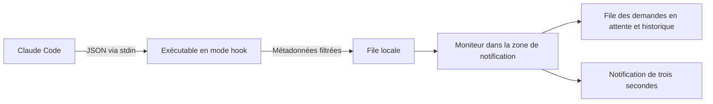

# CodePing

[English](README.md) · [Português](README.pt-BR.md) · [Español](README.es.md) · [Deutsch](README.de.md) · **Français** · [简体中文](README.zh-Hans.md)


**Une brève notification lorsque Claude Code a besoin de vous. Une file pour votre retour.**

Application locale pour **Windows 10/11 x64**, développée en C# / .NET 10 et WPF. Elle suit les sessions locales de Claude Code, y compris dans VS Code, et signale les questions, les autorisations, les réponses terminées et les erreurs. La notification décompte **trois secondes** et ne demande pas le focus de saisie. Elle reste visible pour la lecture lorsque le pointeur est dessus ; lorsque vous retirez le pointeur après ce délai, elle se ferme immédiatement.

**Version 1.6.0 · thème Clair · six langues.** La marque reste CodePing dans les six langues. Consultez l’[historique des versions](CHANGELOG.md) et l’[organisation visuelle approuvée](design/NAVEGACAO.md).


*Captures de l’application réelle en portugais, avec des données de test fictives. L’interface propose les six langues ci-dessus.*

## Fonctionnalités

| Fonctionnalité | Ce que vous pouvez faire |
| --- | --- |
| **Plusieurs projets et conversations** | Suivre des sessions simultanées, identifiées par projet et conversation. |
| **Alertes d’action et de fin de réponse** | Recevoir des notifications pour les questions, les autorisations, les plans en attente d’approbation, les demandes de saisie, les réponses terminées et les erreurs. |
| **Brève notification avec lecture au survol** | Voir une notification de trois secondes sans perdre le focus ; la garder ouverte en plaçant le pointeur dessus. |
| **Son et notification indépendants** | Choisir les canaux d’alerte globaux et personnaliser le son de chaque profil. |
| **File persistante** | Consulter les demandes encore en attente, même après avoir redémarré le programme. |
| **Report individuel** | Reporter chaque demande de 5, 15 ou 30 minutes ; depuis la notification, la reporter de 15 minutes. |
| **Rappels limités** | Utiliser des rappels progressifs, un intervalle fixe ou aucune répétition automatique. |
| **Profils visibles** | Passer de Normal à Occupé ou Silencieux, avec les options de chaque profil toujours ouvertes. |
| **Reprise et résumé** | Programmer le retour au mode Normal ou utiliser De retour et consulter ce qui s’est passé pendant votre absence. |
| **Noms reconnaissables** | Utiliser le titre personnalisé reçu de Claude ou choisir un surnom local pour chaque conversation et projet. |
| **Règles par projet** | Épingler, mettre en sourdine, choisir les catégories et régler les rappels sans modifier les autres projets. |
| **Historique local** | Consulter les réponses confirmées, les fins de réponse, les erreurs et les fermetures, avec une conservation de 24 heures et jusqu’à 500 activités. |
| **Retour à l’éditeur** | Ouvrir le dossier du projet dans VS Code ou tenter de restaurer sa fenêtre existante. |
| **Zone de notification Windows** | Garder le moniteur en arrière-plan, ouvrir le panneau, tester les notifications et les suspendre temporairement. |
| **Six langues** | Passer immédiatement du portugais à l’anglais, à l’espagnol, à l’allemand, au français ou au chinois simplifié. |
| **Diagnostic** | Vérifier l’intégration, l’exécutable, l’écriture dans la file et l’heure du dernier événement reçu. |
| **Usage local et accessible** | Utiliser la navigation au clavier, un focus visible et les réglages de contraste élevé, sans envoyer de données à des services réseau. |
| **Identité et mise à jour compatible** | Utiliser le logo CodePing, conserver les anciens réglages et ne garder que la version locale actuelle grâce à l’empaquetage. |

## Quelles situations déclenchent des notifications

| Situation | Notification ou comportement |
| --- | --- |
| Claude demande une autorisation pour un outil | **Autorisation nécessaire**. |
| Claude utilise AskUserQuestion | **Claude a une question**. |
| Claude soumet un plan à approbation avec ExitPlanMode | **Plan en attente d’approbation**. |
| L’intégration demande une réponse, y compris via les notifications de saisie/MCP | **Réponse nécessaire**, lorsque l’événement correspondant est reçu. |
| Claude termine une réponse | **Réponse terminée**. Cela ne prouve pas que la tâche entière est terminée. |
| Claude émet StopFailure | **Claude s’est arrêté à cause d’une erreur**. |
| La session démarre, envoie un nouveau prompt ou utilise des outils courants | Met à jour l’état de la session ; n’affiche pas une notification pour chaque activité. |
| La session se termine | Retire ses demandes en attente et inscrit la fermeture dans l’historique. |

Les notifications dépendent des préférences globales, du profil et des règles du projet. CodePing suit les événements de Claude Code ; l’inactivité de VS Code, à elle seule, ne déclenche pas de notification.

## Télécharger et exécuter

1. Ouvrez la [dernière version](https://github.com/victorcqueiroz/CodePing/releases/latest) et téléchargez `CodePing-1.6.0-win-x64.zip`.
2. Extrayez **tous les fichiers** dans un dossier définitif et ouvrez `CodePing.exe`.
3. Ouvrez **Préférences → Activer l’intégration**. Si elle est déjà configurée, l’action s’intitule **Actualiser l’intégration**.
4. Ouvrez une nouvelle conversation Claude Code dans VS Code pour charger la configuration.
5. Utilisez **Préférences → Tester la notification**. Vous pouvez fermer le panneau et le laisser dans la zone de notification.

Le paquet inclut le runtime .NET ; il n’est pas nécessaire d’installer le SDK pour l’utiliser. Il nécessite une installation locale de Claude Code avec des hooks de commande acceptant `command`, `args` et `onFailure` (intégration initialement validée avec Claude Code 2.1.312). Le bouton de retour à l’éditeur nécessite VS Code. L’exécutable ne possède pas de signature numérique commerciale.

Le fichier `SHA256SUMS.txt` de la publication permet de vérifier le ZIP :

```powershell
Get-FileHash .\CodePing-1.6.0-win-x64.zip -Algorithm SHA256
```

Gardez les fichiers du paquet ensemble. Les hooks enregistrent le chemin de l’exécutable ; si vous changez de dossier, actualisez l’intégration depuis le nouvel emplacement.

### Notifications et fonctionnement dans la zone de notification

Dans **Préférences**, le son et la notification peuvent être activés ou désactivés séparément. Le son dépend aussi de l’option du profil ; Silencieux bloque les deux. Désactiver les alertes n’interrompt pas la collecte des événements et n’efface pas les demandes en attente.

La notification apparaît en bas à droite de la zone de travail de l’écran où se trouve le pointeur, reste au-dessus des autres fenêtres et ne demande pas le focus de saisie. Elle affiche le projet, la conversation, l’état et le compte à rebours. Utilisez **Ouvrir VS Code** pour revenir au projet ; les demandes en attente proposent aussi **Reporter de 15 min**. Le menu contextuel de la notification permet de suspendre les alertes pendant cinq minutes.

Les trois secondes continuent de s’écouler lorsque le pointeur est sur la notification. Si le délai expire pendant la lecture, elle affiche **Lecture** et reste ouverte. Lorsque vous retirez le pointeur après ce délai, elle se ferme immédiatement ; si vous le retirez avant, seul le temps restant est utilisé.

Fermer ou réduire le panneau le place dans la zone de notification et laisse le moniteur fonctionner. Double-cliquez sur l’icône pour le rouvrir. Le menu de la zone de notification permet d’ouvrir le panneau, de tester une notification, de suspendre les alertes pendant cinq minutes, de revenir au mode Normal, de désactiver l’intégration et de quitter. Ouvrir une deuxième fois l’exécutable réutilise l’instance existante.

Si l’intégration est active, un prochain événement de Claude peut relancer le moniteur après **Quitter**. Cela ne correspond pas à un enregistrement de démarrage automatique à l’ouverture d’une session Windows.

## Marque et compatibilité

CodePing est le nouveau nom de Claude Alert / Claude Alerta. Le logo associe un symbole de code à un point de notification ; le bleu accompagne le thème Clair et le vert représente le ping.

Le paquet contient **CodePing.exe** comme exécutable principal. `ClaudeAlerta.exe` est une copie de l’apphost **de cette même version**, pour que les raccourcis et les hooks ayant déjà chargé l’ancien chemin continuent de fonctionner. Les deux utilisent le même moniteur et les mêmes données, sans démarrer deux instances. Actualisez l’intégration pour utiliser le nouveau nom.

Les données restent dans `%LOCALAPPDATA%\ClaudeAlerta`, en conservant les préférences, les langues, les profils, les surnoms, les demandes en attente et l’historique. Sur la machine de développement, le dossier d’installation reste `release/ClaudeAlerta` ; le fichier principal est désormais `CodePing.exe`. L’adresse officielle du dépôt est [victorcqueiroz/CodePing](https://github.com/victorcqueiroz/CodePing).

Les fichiers de la marque se trouvent dans [Assets](Assets/README.md) : SVG modifiable, PNG transparent et ICO avec neuf tailles. Pour régénérer les PNG et l’ICO sous Windows, utilisez `scripts/brand-assets.ps1`.

## Navigation latérale

Le panneau s’ouvre sur **Sessions**. Un menu unique à gauche donne accès aux cinq rubriques :

| Rubrique | Contenu |
| --- | --- |
| **En attente** | File des demandes, contexte et report individuel. Le nombre dans le menu indique combien attendent encore une action. |
| **Sessions** | Toutes les sessions suivies, le résumé de l’absence et les profils d’alertes. |
| **Historique** | Réponses confirmées, réponses terminées, erreurs et fermetures des dernières 24 heures. |
| **Projets** | Surnoms, épinglage, mise en sourdine et règles individuelles. |
| **Préférences** | Son, notification, rappels, test de notification et diagnostic de l’intégration. |

Les commandes ont un focus visible et une sémantique native pour la navigation au clavier. Dans les petites fenêtres, Sessions et Préférences utilisent un défilement vertical. La hauteur des longues listes de sessions est limitée afin de garder les profils accessibles.

## En attente : les demandes qui vous attendent

Chaque demande possède sa propre ligne, son projet, le nom de la conversation et l’outil, lorsqu’il est disponible. Les questions parallèles d’une même session restent séparées.


- **Reporter le rappel :** choisissez 5, 15 ou 30 minutes pour la demande sélectionnée. La notification propose aussi **Reporter de 15 min**.
- **Ouvrir le projet dans VS Code :** tente de restaurer la fenêtre correspondant au projet ou d’ouvrir son dossier. Ne sélectionne pas une conversation particulière.

Fermer la notification, ouvrir l’éditeur ou reporter **ne répond pas à Claude et ne résout pas la demande en attente**. Une confirmation correspondante retire la demande de la file. Terminer la session retire aussi ses demandes en attente et inscrit la fermeture. En cas de doute sur la correspondance entre des outils parallèles, l’application conserve la demande pour éviter de la masquer par erreur.

Les demandes en attente et les reports survivent au redémarrage. Les états récupérés affichent **Restauré · en attente d’un nouvel événement**, car le dernier état enregistré ne prouve pas que la session est toujours active. Les données sont conservées pendant 24 heures ; l’historique garde jusqu’à 500 activités. Ce délai s’applique aussi aux anciennes demandes d’une session encore ouverte.

L’ancien bouton **Vu** a été remplacé par le report explicite, pour qu’une demande encore sans réponse ne perde pas ses rappels indéfiniment.

## Sessions : profils et activité

**Vos sessions** apparaît en premier, avec les sessions en cours de travail et celles en attente de réponse. Juste en dessous se trouvent les trois cartes de **Profil d’alertes**. Cliquez n’importe où sur une carte pour la sélectionner ; le profil actif est mis en évidence et porte la mention **Actif**.

Les options dans **Alertes du profil…** restent toujours ouvertes et changent immédiatement avec la sélection. Il n’y a ni menu ni commande de déploiement pour personnaliser les autorisations/questions, les fins de réponse, les erreurs et le son.


| Profil | Comportement par défaut |
| --- | --- |
| **Normal** | Autorise les questions, les autorisations, les fins de réponse et les erreurs. |
| **Occupé** | Autorise les questions, les autorisations et les erreurs ; conserve les fins de réponse sans notification et désactive le son du profil. |
| **Silencieux** | Bloque toutes les notifications et tous les sons ; continue de recevoir les événements et d’enregistrer l’activité. |

Dans Normal et Occupé, vous pouvez choisir les catégories autorisées et le son du profil. Le son doit aussi être activé dans les préférences globales. Le mode Silencieux bloque toujours les alertes, même si un projet est configuré pour les autoriser.

Dans Occupé ou Silencieux, choisissez une reprise **manuelle**, dans **15 minutes**, **30 minutes** ou **1 heure**. Le délai est enregistré et respecté après le redémarrage du programme. **De retour** rétablit Normal dans l’écran Sessions, où le résumé indique les réponses terminées et les erreurs qui n’ont pas déclenché d’alerte pendant votre absence. Les demandes restent dans En attente. Passer d’Occupé à Silencieux conserve cette période ; la reprise automatique ne force pas l’ouverture du panneau.

Dans les autres rubriques, le raccourci **Profil : …** mène directement aux cartes de Sessions. L’option **Voir l’historique** ouvre l’activité détaillée.

Dans le menu de la zone de notification, **Suspendre les alertes 5 minutes** applique Silencieux avec un retour automatique. Le panneau peut être ouvert en double-cliquant sur l’icône.

### Rappels avec une limite

Dans **Préférences**, choisissez la politique globale :

- **Progressif :** premier rappel après 2 minutes ; les suivants après des intervalles de 5 et 15 minutes.
- **Intervalle fixe :** 30 secondes, 1 minute ou 2 minutes, en conservant les options de la version précédente.
- **Aucun rappel :** désactive les répétitions automatiques.

Il y a **jusqu’à trois rappels supplémentaires par demande**. Reporter réinitialise cette limite et programme le prochain rappel pour le délai choisi. Même lorsque les répétitions automatiques sont désactivées, un report explicite programme un unique rappel de retour. Le profil, les règles du projet et les préférences de notification/son restent respectés. Des demandes différentes n’ouvrent pas de rappels simultanés ; le moniteur espace ces rappels d’au moins dix secondes.

Les réponses terminées et les erreurs reçoivent une notification initiale lorsque cela est autorisé, sans répétition automatique. Le compte à rebours de la notification reste de trois secondes. Si le pointeur est sur la notification à l’expiration de ce délai, elle reste visible et affiche **Lecture**. Lorsque vous retirez le pointeur après le délai, elle se ferme immédiatement. Placer ou retirer le pointeur avant ne suspend pas et ne réinitialise pas le compte à rebours.


## Identifier le projet et la conversation

La notification met **le projet** en évidence, affiche **la conversation** sur une ligne distincte et indique l’état : réponse terminée, autorisation, question ou erreur. Elle se ferme automatiquement après trois secondes, en restant ouverte au survol pour la lecture, sans demander le focus.

L’identification suit cet ordre :

1. **Surnom local**, défini dans **Nom de la conversation**.
2. **Titre personnalisé de Claude**, lorsqu’il est reçu par l’intégration.
3. **Identifiant court de la session**, lorsqu’aucun nom n’est disponible.

Dans **Sessions**, chaque ligne propose **Nom de la conversation**. Dans **En attente** et **Historique**, la même action se trouve dans le détail à droite. L’éditeur affiche le projet, le titre reçu et l’identifiant complet. Enregistrez un surnom ou laissez le champ vide pour revenir au titre/à l’identifiant. Le surnom est propre à cette session, même si plusieurs conversations utilisent le même dossier ou portent le même nom ; il ne renomme pas la conversation dans Claude Code.

L’identification apparaît aussi dans les listes de Projets. Les noms acceptent jusqu’à 160 caractères Unicode et sont normalisés sur une seule ligne. Les noms longs sont abrégés visuellement ; survolez-les pour consulter le texte complet dans les listes et dans la notification.

La collecte utilise le champ facultatif `session_title` de [SessionStart](https://code.claude.com/docs/en/hooks#sessionstart-input) et [UserPromptSubmit](https://code.claude.com/docs/en/hooks#userpromptsubmit-input). Elle dépend de la présence de ce champ dans la version installée de Claude Code. Un nom personnalisé peut être défini dans Claude avec `/rename` ; l’intégration le reçoit lors d’un événement compatible ultérieur. **Les titres générés automatiquement ne figurent pas dans ce champ.** L’application ne lit pas la conversation ni la transcription pour essayer de les trouver. Les événements sans titre conservent le dernier titre reçu ; un titre explicitement vide l’efface.

Les titres reçus restent dans l’état et dans les activités, même après la fermeture de la session, dans la limite des 24 heures de conservation. Les surnoms choisis restent dans les préférences jusqu’à leur suppression. Les fichiers des versions précédentes continuent de fonctionner sans migration manuelle. **Ouvrir VS Code** continue d’ouvrir le projet, sans sélectionner une conversation particulière.

## Projets : règles indépendantes


Les projets apparaissent à la réception de leurs événements. Vous pouvez :

- donner un surnom qui apparaît uniquement dans le panneau et les notifications, sans renommer le dossier ;
- épingler les projets les plus utilisés en tête de liste ;
- mettre un projet en sourdine sans affecter les autres ;
- autoriser ou bloquer les autorisations/questions, les fins de réponse et les erreurs ;
- hériter de l’intervalle global des rappels ou en choisir un autre pour ce projet ;
- consulter les noms des conversations et les états connus des sessions.

Les règles du projet **restreignent** le profil actuel : une alerte doit être autorisée par les deux. Les dossiers sont comparés sans tenir compte des majuscules, des minuscules ni de la barre oblique finale. Des noms identiques dans des dossiers différents restent des projets distincts.

## Vérifier l’intégration

Dans **Préférences**, **Vérifier l’intégration** contrôle l’exécutable, la présence des handlers attendus dans la configuration de l’utilisateur et la possibilité d’écrire dans la file locale. La même rubrique affiche séparément la date du **dernier événement reçu**.

Une configuration valide ne prouve pas que de nouveaux événements sont transmis. Le flux complet n’est confirmé que lorsqu’un véritable événement de Claude arrive. L’absence d’événements n’est pas considérée comme un blocage ou une déconnexion ; une réponse longue peut ne produire aucun événement pendant un certain temps. Les politiques, les réglages du projet et `disableAllHooks` peuvent affecter l’exécution des hooks.

## Langues

En bas à droite, le sélecteur discret propose **Português, English, Español, Deutsch, Français et 简体中文**. Le changement est immédiat, couvre toute la navigation, les cartes, les options des profils, les notifications et la zone de notification, et reste enregistré pour la prochaine ouverture. La langue ne modifie pas l’état des demandes en attente et ne réinitialise pas le délai d’une notification ouverte.

Le portugais est la langue par défaut. Les préférences de la version 1.2.0 conservent la langue, le son, la notification et l’intervalle des rappels. Les nouvelles installations démarrent avec des rappels progressifs. Les catalogues sont intégrés au programme et n’utilisent pas de traduction en ligne.

## Données locales et confidentialité

Le programme utilise les [hooks officiels de Claude Code](https://code.claude.com/docs/en/hooks). Il ne tente pas d’interpréter les images de l’écran ni de déduire l’activité à partir de l’utilisation du processeur.



Le même exécutable reçoit rapidement les événements en mode hook et maintient le moniteur, qui interroge la file toutes les 500 ms. Les événements temporaires sont supprimés après leur consommation et leur enregistrement ; ceux de plus de dix minutes sont ignorés. Les événements identiques récents sont dédupliqués, même après un redémarrage.

Dans `%LOCALAPPDATA%\ClaudeAlerta` :

| Fichier/dossier | Contenu |
| --- | --- |
| `preferences.json` | Langue, son, notification, profil, délai de retour, surnoms des projets/conversations et règles par projet. |
| `activity.json` | Sessions, titres personnalisés, demandes, reports, identifiants des outils, historique et heure du dernier événement. |
| `inbox/` | Métadonnées temporaires des événements. |

Seuls les identifiants de session/d’outil, le dossier du projet, les noms d’événement/d’outil, le type de notification, les titres personnalisés reçus et les horaires sont stockés, ainsi que les états dérivés et les préférences choisies. **Les prompts, les réponses, les commandes, le contenu des fichiers, les messages de notification et les transcriptions sont supprimés avant l’enregistrement.** L’application ne capture pas l’écran, n’approuve aucune opération et n’effectue aucune requête réseau. Les captures de test se limitent au rendu des fenêtres de l’application.

L’enregistrement utilise un remplacement atomique de fichier. Si un fichier ne peut pas être restauré, le panneau signale le problème ; avant de le remplacer, il conserve une copie `*.invalid-*.bak`. Ces sauvegardes de récupération ne sont pas soumises à l’expiration automatique de 24 heures. Si l’enregistrement de l’activité échoue, l’événement reste dans la file pour une nouvelle tentative et le panneau signale l’échec.

L’intégration modifie `~/.claude/settings.json`, en conservant les autres réglages et hooks et en créant une copie `settings.json.claude-alerta-*.bak` avant la modification. Pour la désactiver, choisissez **Désactiver l’intégration** dans la zone de notification, puis **Quitter**. Quitter uniquement permet au prochain événement de relancer le moniteur.

## Commandes disponibles

Exécutez-les dans le dossier extrait de l’application :

| Commande | Action |
| --- | --- |
| `.\CodePing.exe` | Ouvre le panneau ou demande l’ouverture de l’instance déjà existante. |
| `.\CodePing.exe --tray` | Démarre le moniteur réduit dans la zone de notification. |
| `.\CodePing.exe --install-hooks` | Installe ou actualise l’intégration, en conservant les autres réglages et en créant une sauvegarde lorsqu’un fichier existe déjà. |
| `.\CodePing.exe --remove-hooks` | Supprime uniquement les handlers appartenant à l’application. |
| `.\CodePing.exe --shutdown` | Demande l’arrêt du moniteur en cours d’exécution. |

Les scripts de test utilisent des modes de diagnostic avec un stockage isolé ; il n’est pas nécessaire de les utiliser pour suivre Claude Code.

## Limitations

- Surveille les sessions **locales** du compte Windows, y compris dans le terminal ; ne se limite pas à l’extension VS Code.
- WSL, SSH, les conteneurs et les sessions dans le cloud nécessitent une passerelle supplémentaire que ce projet n’implémente pas. Codex n’est pas surveillé.
- `Stop` signifie la fin d’une réponse, pas l’achèvement intégral de la tâche. `idle_prompt` est un rappel d’inactivité, pas une preuve de blocage du traitement.
- `PermissionRequest` ne fournit pas de `tool_use_id`. Lorsqu’il est impossible de corréler avec certitude une autorisation parallèle, elle reste en attente jusqu’à une confirmation sans ambiguïté, la fermeture de la session ou l’expiration.
- Des événements perdus ou reçus dans le désordre peuvent laisser un état non confirmé. Vérifiez la conversation dans Claude ; le moniteur ne prend pas de décisions à votre place.
- Le retour à VS Code n’identifie pas la conversation exacte. Les jeux en plein écran exclusif peuvent masquer la notification.
- Une seule notification s’affiche à la fois ; une nouvelle notification peut remplacer la précédente, même pendant la lecture au survol. Les demandes restent disponibles dans la file et les événements de fin de réponse/d’erreur dans l’historique.
- Le nettoyage s’effectue tant que le moniteur est ouvert ou lorsqu’il redémarre ; aucun service de nettoyage ne fonctionne lorsque l’application est fermée.

## Compiler, tester et empaqueter

Nécessite le [SDK .NET 10](https://dotnet.microsoft.com/download/dotnet/10.0), Windows x64 et PowerShell 7 :

```powershell
git clone https://github.com/victorcqueiroz/CodePing.git
cd CodePing
.\scripts\build.ps1
.\scripts\test.ps1 -SkipBuild -Ui
.\scripts\package.ps1 -SkipBuild
```

La publication se trouve dans `artifacts/publish/win-x64/` ; le ZIP et son SHA-256 se trouvent dans `artifacts/releases/1.6.0/`. Pour utiliser un autre SDK local, indiquez `-Dotnet C:\caminho\dotnet.exe` aux scripts de compilation, de test ou d’empaquetage.

### Ne conserver que la dernière version locale

L’empaquetage ne conserve que le paquet de la version actuelle dans `artifacts/releases/`. Les ZIP des versions précédentes ne sont supprimés qu’une fois le nouveau paquet et son SHA-256 disponibles et vérifiés. Les dossiers contenant des versions plus récentes ou un contenu non reconnu sont conservés.

Pour nettoyer aussi les anciennes distributions dans `release/` et `artifacts/` d’un dossier de travail existant :

```powershell
.\scripts\clean-releases.ps1 -LegacyRoot 'C:\caminho\da\pasta-de-trabalho' -WhatIf
.\scripts\clean-releases.ps1 -LegacyRoot 'C:\caminho\da\pasta-de-trabalho'
```

Le nettoyage exige un paquet actuel valide. Il supprime uniquement les anciens dossiers identifiés comme CodePing ou Claude Alert, vérifie les chemins et refuse les liens/jonctions. L’installation sans suffixe `release/ClaudeAlerta`, les données personnelles, les autres projets et l’historique sur GitHub sont conservés. Les mises à jour locales doivent remplacer l’unique dossier d’installation et supprimer les anciens binaires après validation, sans conserver de sauvegardes des versions précédentes.

Après la compilation, exécutez `scripts/test-cleanup.ps1` pour tester cette conservation dans des dossiers isolés, y compris la préservation des autres projets et l’intégration avec l’empaquetage.

Pour compiler uniquement l’exécutable avec le SDK :

```powershell
dotnet publish .\ClaudeAlerta.csproj -c Release -r win-x64 --self-contained true -o .\artifacts\publish\win-x64
```

Les tests utilisent un stockage isolé dans `artifacts/tests/`, en préservant les réglages personnels de Claude. `-Ui` exige une session Windows avec un bureau disponible et peut afficher brièvement des fenêtres. Les résultats, les éléments de preuve et les limites se trouvent dans [VALIDACAO.md](VALIDACAO.md).

Privilégiez `scripts/build.ps1` pour préparer une distribution : il crée une publication propre, inclut la documentation et les fichiers de la marque et génère l’apphost de compatibilité `ClaudeAlerta.exe`. L’appel direct au SDK n’effectue pas ces étapes supplémentaires. Les modifications portant uniquement sur la documentation ne nécessitent pas de nouvelle version de l’exécutable ni de remplacement des sommes de contrôle d’une version déjà publiée.

## Documentation dans d’autres langues

Les six README couvrent les mêmes fonctionnalités, instructions et limitations. Utilisez les liens de langue en haut de page. L’historique des versions, le rapport de validation, le guide de la marque et les documents de conception liés restent en portugais.

## Structure

```text
Program.cs               Initialisation, zone de notification et réception des hooks
Core.cs                  Stockage, filtrage et installation des hooks
MonitorModel.cs          Demandes indépendantes, historique et persistance
Preferences.cs           Profils, règles par projet et politique de rappels
Dashboard.xaml/.cs       Navigation latérale, sessions, profils et diagnostic
AlertCard.xaml(.cs)       Notification de trois secondes et lecture au survol
ConversationEditor.*     Éditeur de surnom local de la conversation
ConversationNames.cs     Normalisation et limite des noms
ClaroTheme.xaml          Thème Clair et styles partagés
Assets/                  Logo SVG/XAML, PNG, ICO et guide de la marque
Localization.cs          Application des langues et langue de repli
Locales/                 Six catalogues intégrés
SelfTest.cs / UiCheck.cs  Tests isolés du moniteur et de l’interface
scripts/                 Compilation, tests et paquet versionné
docs/images/             Captures de démonstration
```

Aucun paquet tiers n’est déclaré. Le logo est une ressource propre au projet ; les autres glyphes et les polices utilisent les ressources système de Windows.
