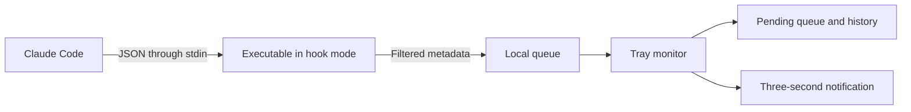

# CodePing

**English** · [Português](README.pt-BR.md) · [Español](README.es.md) · [Deutsch](README.de.md) · [Français](README.fr.md) · [简体中文](README.zh-Hans.md)


**A brief notification when Claude Code needs you. A queue for when you can return.**

A local **Windows 10/11 x64** app built with C# / .NET 10 and WPF. It follows local Claude Code sessions, including those inside VS Code, and notifies you about questions, permissions, completed responses, and errors. Each notification counts down **three seconds** without taking keyboard focus. Keep the pointer over it to read; moving the pointer away after the deadline closes it immediately.

**Version 1.6.0 · Claro light theme · six languages.** The brand is CodePing in all six languages. See the [changelog](CHANGELOG.md) and the [approved visual organization](design/NAVEGACAO.md).


*Screenshots of the actual app in Portuguese, using fictional test data. The interface supports all six languages listed above.*

## Features

| Feature | What you can do |
| --- | --- |
| **Multiple projects and conversations** | Follow concurrent sessions, identified by project and conversation. |
| **Action and completion alerts** | Receive notifications for questions, permissions, plans awaiting approval, requests for input, completed responses, and errors. |
| **Brief notifications with hover reading** | See a three-second popup without losing focus; keep it open by hovering over it. |
| **Independent sound and popup controls** | Choose global notification channels and customize sound per profile. |
| **Persistent queue** | Review requests that still need attention, including after restarting the app. |
| **Per-request deferral** | Defer each request for 5, 15, or 30 minutes; defer for 15 minutes from the popup. |
| **Bounded reminders** | Use progressive reminders, a fixed interval, or no automatic repeats. |
| **Visible profiles** | Switch between Normal, Busy, and Silent, with each profile's options always expanded. |
| **Resume and catch up** | Schedule a return to Normal or use I'm back and review what happened while you were away. |
| **Recognizable names** | Use the custom title received from Claude or choose a local nickname for each conversation and project. |
| **Per-project rules** | Pin, mute, choose categories, and adjust reminders without changing other projects. |
| **Local history** | Review answered requests, completed responses, errors, and session endings, retained for 24 hours with up to 500 activities. |
| **Return to the editor** | Open the project folder in VS Code or try to restore its existing window. |
| **Windows system tray** | Keep monitoring in the background, open the dashboard, test notifications, and mute temporarily. |
| **Six languages** | Switch immediately between Portuguese, English, Spanish, German, French, and Simplified Chinese. |
| **Diagnostics** | Check the integration, executable, queue writes, and the time of the last received event. |
| **Local and accessible** | Use keyboard navigation, visible focus, and high-contrast adjustments without sending data to network services. |
| **Branding and compatible upgrades** | Use the CodePing logo, keep existing settings, and retain only the current local release through packaging. |

## What triggers notifications

| Situation | Notification or behavior |
| --- | --- |
| Claude requests permission for a tool | **Permission required**. |
| Claude uses AskUserQuestion | **Claude has a question**. |
| Claude submits a plan for approval with ExitPlanMode | **Plan awaiting approval**. |
| An integration requests a reply, including input/MCP notifications | **Response required**, when the corresponding event is received. |
| Claude finishes a response | **Response complete**. This does not prove that the entire task is finished. |
| Claude emits StopFailure | **Claude stopped due to an error**. |
| A session starts, submits a new prompt, or uses ordinary tools | Updates the session state; does not show a popup for every activity. |
| A session ends | Removes its pending requests and records the session ending in history. |

Notifications depend on global preferences, the profile, and project rules. CodePing follows Claude Code events; VS Code inactivity alone does not trigger a notification.

## Download and run

1. Open the [latest release](https://github.com/victorcqueiroz/CodePing/releases/latest) and download `CodePing-1.6.0-win-x64.zip`.
2. Extract **all files** to a permanent folder and open `CodePing.exe`.
3. Open **Preferences → Enable integration**. If already configured, the action appears as **Refresh integration**.
4. Open a new Claude Code conversation in VS Code to load the configuration.
5. Use **Preferences → Test notification**. You can close the dashboard and leave the app in the system tray.

The package includes the .NET runtime; you do not need the SDK to use it. It requires local Claude Code with command hooks that accept `command`, `args`, and `onFailure` (integration originally validated with Claude Code 2.1.312). The return button requires VS Code. The executable does not have a commercial code-signing certificate.

Use the release's `SHA256SUMS.txt` to verify the ZIP:

```powershell
Get-FileHash .\CodePing-1.6.0-win-x64.zip -Algorithm SHA256
```

Keep the package files together. Hooks store the executable's path; if you move the folder, refresh the integration from the new location.

### Notifications and the system tray

In **Preferences**, sound and popups can be enabled or disabled separately. Sound also depends on the profile setting; Silent blocks both. Disabling notifications does not stop event collection or erase pending requests.

The popup appears in the bottom-right corner of the working area of the monitor containing the pointer, stays above other windows, and does not take keyboard focus. It shows the project, conversation, status, and countdown. Use **Open VS Code** to return to the project; pending requests also offer **Defer 15 min**. The notification's context menu lets you mute for five minutes.

The three seconds keep counting while the pointer is over the notification. If the deadline expires while you are reading, it displays **Reading** and stays open. Moving the pointer away after the deadline closes it immediately; leaving earlier uses only the remaining time.

Closing or minimizing the dashboard sends it to the system tray and keeps monitoring active. Double-click the icon to reopen it. The tray menu lets you open the dashboard, test a notification, mute for five minutes, return to Normal, disable the integration, and exit. Launching the executable a second time reuses the existing instance.

If the integration is active, a subsequent Claude event can start the monitor again after **Exit**. This is not registration for automatic startup at Windows login.

## Branding and compatibility

CodePing is the new name of the former Claude Alert / Claude Alerta. The logo combines a code symbol with a notification dot; blue matches the existing Claro theme, and green represents the ping.

The package provides **CodePing.exe** as the main executable. `ClaudeAlerta.exe` is a copy of the apphost from **this same version**, keeping shortcuts and hooks that have already loaded the old path working. Both use the same monitor and data without starting two instances. Refresh the integration to use the new name.

Data remains in `%LOCALAPPDATA%\ClaudeAlerta`, preserving preferences, languages, profiles, nicknames, pending requests, and history. On the development machine, the installation folder remains `release/ClaudeAlerta`; the main file is now `CodePing.exe`. The official repository is [victorcqueiroz/CodePing](https://github.com/victorcqueiroz/CodePing).

Brand assets are in [Assets](Assets/README.md): editable SVG, transparent PNG, and an ICO with nine sizes. To regenerate the PNGs and ICO on Windows, run `scripts/brand-assets.ps1`.

## Sidebar navigation

The dashboard opens on **Sessions**. A single menu on the left provides access to five areas:

| Area | Contents |
| --- | --- |
| **Pending** | Request queue, context, and individual deferral. The menu count shows how many requests still need action. |
| **Sessions** | All monitored sessions, the absence summary, and notification profiles. |
| **History** | Answered requests, completed responses, errors, and session endings from the last 24 hours. |
| **Projects** | Nicknames, pinning, muting, and individual rules. |
| **Preferences** | Sound, popups, reminders, test notifications, and integration diagnostics. |

Controls have visible focus and native keyboard navigation semantics. On smaller windows, Sessions and Preferences scroll vertically. Long session lists have a bounded height to keep profiles accessible.

## Pending: what still needs you

Each request has its own row, project, conversation name, and tool when available. Parallel questions within the same session stay separate.


- **Defer reminder:** choose 5, 15, or 30 minutes for the selected request. The notification also offers **Defer 15 min**.
- **Open project in VS Code:** tries to restore the matching project window or open its folder. It does not select a specific conversation.

Closing the notification, opening the editor, or deferring **does not answer Claude or resolve the request**. A corresponding confirmation removes the request from the queue. Ending the session also removes its pending requests and records the session ending. When parallel tool calls cannot be matched confidently, the app keeps the request pending to avoid hiding it by mistake.

Pending requests and deferrals survive restarts. Recovered states show **Restored · awaiting a new event**, since the last saved state does not prove that a session is still active. Records are retained for 24 hours; history holds up to 500 activities. This deadline also applies to old requests in a session that is still open.

The former **Seen** acknowledgement button was replaced with explicit deferral so an unanswered request does not lose its reminders indefinitely.

## Sessions: profiles and activity

**Your sessions** comes first, including sessions that are working and those awaiting a reply. The three **Alert profile** cards sit directly below. Click anywhere on a card to select it; the active profile is highlighted and marked **In use**.

The options under **Alerts for…** stay expanded and change immediately with the selection. No menu or expander is needed to customize permissions/questions, completions, errors, and sound.


| Profile | Default behavior |
| --- | --- |
| **Normal** | Allows questions, permissions, completions, and errors. |
| **Busy** | Allows questions, permissions, and errors; stores completions without a popup and turns off the profile's sound. |
| **Silent** | Blocks all popups and sounds; continues receiving events and storing activity. |

In Normal and Busy, you can choose allowed categories and profile sound. Sound must also be enabled in global preferences. Silent always blocks notifications, even if a project is configured to allow them.

In Busy or Silent, choose to resume **when you return**, in **15 minutes**, **30 minutes**, or **1 hour**. The deadline is saved and respected after restarting the app. **I'm back** returns to Normal on the Sessions page, where the summary shows completed responses and errors that went without notifications while you were away. Requests remain in Pending. Switching between Busy and Silent preserves that absence period; automatic resumption does not force the dashboard open.

In other areas, the **Profile: …** shortcut takes you directly to the cards in Sessions. **View history** opens the detailed activity log.

In the tray menu, **Mute for 5 minutes** applies Silent with an automatic return. Double-click the icon to open the dashboard.

### Bounded reminders

In **Preferences**, choose the global policy:

- **Progressive:** the first reminder after 2 minutes; subsequent reminders after intervals of 5 and 15 minutes.
- **Fixed interval:** 30 seconds, 1 minute, or 2 minutes, preserving the previous version's options.
- **No reminders:** disables automatic repeats.

There are **up to three additional reminders per request**. Deferring resets this limit and schedules the next reminder for the chosen deadline. Even with automatic repeats disabled, an explicit deferral schedules one return. Profile, project rules, and popup/sound preferences still apply. Reminders for different requests do not open simultaneously; the monitor spaces those reminders at least ten seconds apart.

Completed responses and errors receive an initial notification when allowed, without automatic repeats. The popup's clock remains three seconds. If the pointer is over it when the deadline expires, it stays visible and shows **Reading**. Moving away after the deadline closes it immediately. Entering or leaving earlier does not pause or restart the countdown.


## Identifying projects and conversations

The notification highlights **the project**, shows **the conversation** on its own line, and reports the status: completed response, permission, question, or error. It closes automatically after three seconds, respecting hover reading without taking focus.

Identification uses this priority order:

1. **Local nickname**, set through **Conversation name**.
2. **Custom Claude title**, when received through the integration.
3. **Short session ID**, when no name is available.

In **Sessions**, each row offers **Conversation name**. In **Pending** and **History**, the same action is in the details on the right. The editor shows the project, received title, and full ID. Save a nickname or leave the field empty to return to the title/ID. A nickname belongs only to that session, even when several conversations share a folder or title; it does not rename the conversation in Claude Code.

Identification also appears in project session lists. Names accept up to 160 Unicode characters and are normalized to one line. Long names are visually truncated; hover over them to read the full text in lists and notifications.

Capture uses the optional `session_title` field in [SessionStart](https://code.claude.com/docs/en/hooks#sessionstart-input) and [UserPromptSubmit](https://code.claude.com/docs/en/hooks#userpromptsubmit-input). This depends on the installed Claude Code version supplying the field. You can set a custom name in Claude with `/rename`; the integration receives it on a subsequent compatible event. **Automatically generated titles are not included in that field.** The app does not read conversations or transcripts to discover them. Events without a title preserve the last one received; an explicitly empty title clears it.

Received titles are stored in session state and activities, including after a session ends, within the 24-hour retention period. Chosen nicknames stay in preferences until removed. Files from earlier versions continue to work without manual migration. **Open VS Code** still opens the project without selecting a specific conversation.

## Projects: independent rules


Projects appear as their events arrive. You can:

- choose a nickname shown only in the dashboard and notifications without renaming the folder;
- pin frequently used projects at the top;
- mute one project without affecting the others;
- allow or block permissions/questions, completions, and errors;
- inherit the global reminder interval or choose a different one for that project;
- review conversation names and known session states.

Project rules **restrict** the active profile: a notification must be allowed by both. Folder comparisons ignore case and trailing slashes. Identical names in different folders remain separate projects.

## Checking the integration

In **Preferences**, **Check integration** checks the executable, the expected handlers in the user's configuration, and the ability to write to the local queue. The same area separately shows the time of the **last received event**.

A valid configuration does not prove that new events are being delivered. The full flow is confirmed only when an actual Claude event arrives. A lack of events is not treated as a hang or disconnection; a long response may produce no events for some time. Policies, project settings, and `disableAllHooks` can affect hook execution.

## Languages

The discreet selector in the bottom-right corner offers **Português, English, Español, Deutsch, Français, and 简体中文**. Switching is immediate, covers all navigation, cards, profile options, notifications, and the tray, and is saved for the next launch. Language changes do not alter pending request states or restart an open notification's deadline.

Portuguese is the default. Preferences from version 1.2.0 keep language, sound, popup, and reminder interval settings. New installations start with progressive reminders. Catalogs are embedded in the app and do not use online translation.

## Local data and privacy

The app uses [official Claude Code hooks](https://code.claude.com/docs/en/hooks). It does not interpret screen images or infer activity from CPU usage.



The same executable quickly receives events in hook mode and runs the monitor, which polls the queue every 500 ms. Temporary events are deleted after being consumed and saved; events older than ten minutes are discarded. Recent identical events are deduplicated, including across restarts.

In `%LOCALAPPDATA%\ClaudeAlerta`:

| File/folder | Contents |
| --- | --- |
| `preferences.json` | Language, sound, popups, profile, return deadline, project/conversation nicknames, and project rules. |
| `activity.json` | Sessions, custom titles, requests, deferrals, tool IDs, history, and last event time. |
| `inbox/` | Temporary event metadata. |

Only session/tool IDs, project folder, event/tool names, notification type, received custom titles, and timestamps are stored, along with derived states and chosen preferences. **Prompts, responses, commands, file contents, notification messages, and transcripts are discarded before writing.** The app does not capture the screen, approve operations, or make network requests. Test screenshots render only the app's own windows.

Writes use atomic file replacement. If a file cannot be restored, the dashboard reports the problem; before replacing it, the app keeps a `*.invalid-*.bak` copy. Those recovery backups are not covered by automatic 24-hour expiration. If activity cannot be saved, the event remains in the queue for a retry and the dashboard reports the failure.

The integration changes `~/.claude/settings.json`, preserving other settings and hooks and creating a `settings.json.claude-alerta-*.bak` copy before the change. To disable it, select **Disable integration** in the tray and then **Exit**. Exiting alone allows the next event to start the monitor again.

## Available commands

Run these from the extracted app folder:

| Command | Action |
| --- | --- |
| `.\CodePing.exe` | Opens the dashboard or requests that the existing instance open. |
| `.\CodePing.exe --tray` | Starts the monitor minimized to the system tray. |
| `.\CodePing.exe --install-hooks` | Installs or updates the integration, preserving other settings and creating a backup when a file already exists. |
| `.\CodePing.exe --remove-hooks` | Removes only the app's own handlers. |
| `.\CodePing.exe --shutdown` | Requests that the running monitor exit. |

Test scripts use diagnostic modes with isolated storage; you do not need them to monitor Claude Code.

## Limitations

- Monitors **local** sessions under the Windows account, including terminal sessions; it is not exclusive to the VS Code extension.
- WSL, SSH, containers, and cloud sessions need an additional bridge that this project does not implement. Codex is not monitored.
- `Stop` means the end of a response, not the completion of an entire task. `idle_prompt` is an idle reminder, not proof that processing is stuck.
- `PermissionRequest` does not supply `tool_use_id`. When a parallel permission request cannot be matched safely, it remains pending until an unambiguous confirmation, session ending, or expiration.
- Lost or out-of-order events can leave a state unconfirmed. Check the conversation in Claude; the monitor does not make decisions for you.
- Returning to VS Code does not identify the exact conversation. Games in exclusive fullscreen mode may cover the notification.
- There is one popup at a time; a new notification may replace the previous one, even during hover reading. Requests remain in the queue, and completion/error events in history.
- Cleanup runs while the monitor is open or when it starts again; there is no cleanup service while the app is closed.

## Build, test, and package

Requires the [.NET 10 SDK](https://dotnet.microsoft.com/download/dotnet/10.0), Windows x64, and PowerShell 7:

```powershell
git clone https://github.com/victorcqueiroz/CodePing.git
cd CodePing
.\scripts\build.ps1
.\scripts\test.ps1 -SkipBuild -Ui
.\scripts\package.ps1 -SkipBuild
```

The published output is in `artifacts/publish/win-x64/`; the ZIP and its SHA-256 are in `artifacts/releases/1.6.0/`. To use another local SDK, pass `-Dotnet C:\caminho\dotnet.exe` to the build, test, or package script.

### Keep only the latest local release

Packaging retains only the current version's package in `artifacts/releases/`. ZIPs from older versions are removed only after the new package and its SHA-256 are available and verified. Folders containing newer versions or unrecognized content are preserved.

To also clean older distributions under `release/` and `artifacts/` in an existing workspace:

```powershell
.\scripts\clean-releases.ps1 -LegacyRoot 'C:\caminho\da\pasta-de-trabalho' -WhatIf
.\scripts\clean-releases.ps1 -LegacyRoot 'C:\caminho\da\pasta-de-trabalho'
```

Cleanup requires a valid current package. It only removes old folders identified as CodePing or Claude Alert, checks paths, and rejects links/junctions. The unsuffixed `release/ClaudeAlerta` installation, personal data, other projects, and GitHub history are preserved. Local upgrades should replace the single installation folder and discard old binaries after validation, without retaining backups of previous releases.

After building, run `scripts/test-cleanup.ps1` to test retention in isolated folders, including preservation of other projects and integration with packaging.

To publish the executable directly through the SDK:

```powershell
dotnet publish .\ClaudeAlerta.csproj -c Release -r win-x64 --self-contained true -o .\artifacts\publish\win-x64
```

Tests use isolated storage in `artifacts/tests/`, preserving personal Claude settings. `-Ui` requires a Windows desktop session and may briefly show windows. Results, evidence, and limitations are in [VALIDACAO.md](VALIDACAO.md).

Prefer `scripts/build.ps1` when preparing a distribution: it creates a clean published output, includes documentation and brand assets, and generates the `ClaudeAlerta.exe` compatibility apphost. The direct SDK command does not perform those extra steps. Documentation-only changes do not require a new executable version or replacing an already published release's checksums.

## Documentation in other languages

All six READMEs cover the same features, instructions, and limitations. Use the language links at the top. The linked changelog, validation report, brand guide, and design documents remain in Portuguese.

## Structure

```text
Program.cs               Startup, tray, and hook entry point
Core.cs                  Storage, filtering, and hook installation
MonitorModel.cs          Independent requests, history, and persistence
Preferences.cs           Profiles, project rules, and reminder policy
Dashboard.xaml/.cs       Sidebar navigation, sessions, profiles, and diagnostics
AlertCard.xaml(.cs)       Three-second notification and hover reading
ConversationEditor.*     Local conversation nickname editor
ConversationNames.cs     Name normalization and limits
ClaroTheme.xaml          Claro theme and shared styles
Assets/                  SVG/XAML logo, PNGs, ICO, and brand guide
Localization.cs          Language application and fallback
Locales/                 Six embedded catalogs
SelfTest.cs / UiCheck.cs  Isolated monitor and interface tests
scripts/                 Build, tests, and versioned packaging
docs/images/             Demonstration screenshots
```

No third-party packages are declared. The logo is a project asset; other glyphs and fonts use Windows system resources.
