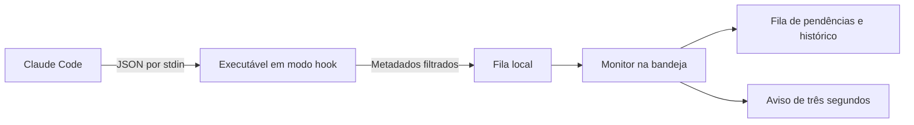

# CodePing

[English](README.md) · **Português** · [Español](README.es.md) · [Deutsch](README.de.md) · [Français](README.fr.md) · [简体中文](README.zh-Hans.md)


**Um aviso breve quando o Claude Code precisar de você. Uma fila para quando você puder voltar.**

Aplicativo local para **Windows 10/11 x64**, feito em C# / .NET 10 e WPF. Acompanha sessões locais do Claude Code, inclusive dentro do VS Code, e avisa sobre perguntas, autorizações, respostas concluídas e erros. O aviso conta **três segundos** e não solicita o foco da digitação. Com o mouse sobre ele, permanece visível para leitura; ao retirar o mouse depois do prazo, fecha imediatamente.

**Versão 1.6.0 · tema Claro · seis idiomas.** A marca é CodePing nos seis idiomas. Consulte o [histórico de versões](CHANGELOG.md) e a [organização visual aprovada](design/NAVEGACAO.md).


*Capturas da aplicação real em português, com dados fictícios de teste. A interface oferece os seis idiomas acima.*

## Funcionalidades

| Recurso | O que você pode fazer |
| --- | --- |
| **Vários projetos e conversas** | Acompanhar sessões simultâneas, com identificação por projeto e conversa. |
| **Alertas de ação e conclusão** | Receber avisos de perguntas, autorizações, planos aguardando aprovação, solicitações de entrada, respostas concluídas e erros. |
| **Aviso breve com leitura pelo mouse** | Ver um popup de três segundos sem perder o foco; mantê-lo aberto passando o mouse sobre ele. |
| **Som e popup independentes** | Escolher os canais globais de aviso e personalizar o som por perfil. |
| **Fila persistente** | Consultar solicitações ainda pendentes, inclusive depois de reiniciar o programa. |
| **Adiamento individual** | Adiar cada solicitação por 5, 15 ou 30 minutos; no popup, adiar por 15 minutos. |
| **Lembretes limitados** | Usar repetição progressiva, intervalo fixo ou nenhuma repetição automática. |
| **Perfis visíveis** | Alternar entre Normal, Ocupado e Silencioso, com as opções de cada perfil sempre abertas. |
| **Retomada e resumo** | Programar o retorno ao Normal ou usar Voltei e consultar o que aconteceu durante sua ausência. |
| **Nomes reconhecíveis** | Usar o título personalizado recebido do Claude ou escolher um apelido local para cada conversa e projeto. |
| **Regras por projeto** | Fixar, silenciar, escolher categorias e ajustar lembretes sem alterar os demais projetos. |
| **Histórico local** | Consultar respostas confirmadas, conclusões, erros e encerramentos, com retenção de 24 horas e até 500 atividades. |
| **Retorno ao editor** | Abrir a pasta do projeto no VS Code ou tentar restaurar sua janela existente. |
| **Bandeja do Windows** | Manter o monitor em segundo plano, abrir o painel, testar avisos e silenciar temporariamente. |
| **Seis idiomas** | Trocar imediatamente entre português, inglês, espanhol, alemão, francês e chinês simplificado. |
| **Diagnóstico** | Verificar integração, executável, escrita da fila e horário do último evento recebido. |
| **Uso local e acessível** | Usar navegação por teclado, foco visível e ajustes de alto contraste, sem enviar dados para serviços de rede. |
| **Identidade e atualização compatível** | Usar a logo CodePing, manter configurações anteriores e conservar somente a release local atual pelo empacotamento. |

## Quais situações geram avisos

| Situação | Aviso ou comportamento |
| --- | --- |
| Claude pede permissão para uma ferramenta | **Autorização necessária**. |
| Claude usa AskUserQuestion | **Claude fez uma pergunta**. |
| Claude envia um plano para aprovação com ExitPlanMode | **Plano aguardando aprovação**. |
| Integração pede uma resposta, inclusive via notificações de entrada/MCP | **Resposta necessária**, quando o evento correspondente é recebido. |
| Claude encerra uma resposta | **Resposta concluída**. Isso não comprova que a tarefa inteira terminou. |
| Claude emite StopFailure | **Claude interrompido por erro**. |
| Sessão inicia, envia um novo prompt ou usa ferramentas comuns | Atualiza o estado da sessão; não gera um popup para cada atividade. |
| Sessão encerra | Retira suas pendências e registra o encerramento no histórico. |

Os avisos dependem das preferências globais, do perfil e das regras do projeto. O CodePing acompanha eventos do Claude Code; a inatividade do VS Code, por si só, não dispara um aviso.

## Baixar e executar

1. Abra a [versão mais recente](https://github.com/victorcqueiroz/CodePing/releases/latest) e baixe `CodePing-1.6.0-win-x64.zip`.
2. Extraia **todos os arquivos** para uma pasta definitiva e abra `CodePing.exe`.
3. Abra **Preferências → Ativar integração**. Se já estiver configurada, a ação aparece como **Atualizar integração**.
4. Abra uma nova conversa do Claude Code no VS Code para carregar a configuração.
5. Use **Preferências → Testar aviso**. Você pode fechar o painel e deixá-lo na bandeja.

O pacote inclui o runtime .NET; não é necessário instalar o SDK para usar. Requer Claude Code local com hooks de comando que aceitem `command`, `args` e `onFailure` (integração originalmente validada com Claude Code 2.1.312). O botão de retorno requer VS Code. O executável não tem assinatura digital comercial.

O arquivo `SHA256SUMS.txt` da publicação permite conferir o ZIP:

```powershell
Get-FileHash .\CodePing-1.6.0-win-x64.zip -Algorithm SHA256
```

Mantenha os arquivos do pacote juntos. Os hooks guardam o caminho do executável; se mudar de pasta, atualize a integração na nova localização.

### Avisos e funcionamento na bandeja

Em **Preferências**, som e popup podem ser ligados ou desligados separadamente. O som também depende da opção do perfil; Silencioso bloqueia ambos. Desligar avisos não interrompe a coleta de eventos nem apaga as pendências.

O popup aparece no canto inferior direito da área útil do monitor onde está o ponteiro, permanece sobre outras janelas e não solicita o foco da digitação. Mostra projeto, conversa, estado e contagem regressiva. Use **Abrir VS Code** para voltar ao projeto; solicitações pendentes oferecem também **Adiar 15 min**. O menu de contexto do aviso permite silenciar por cinco minutos.

Os três segundos continuam correndo com o mouse sobre o aviso. Se o prazo vencer durante a leitura, ele mostra **Em leitura** e permanece aberto. Ao retirar o mouse depois do prazo, fecha imediatamente; sair antes usa somente o tempo restante.

Fechar ou minimizar o painel o recolhe na bandeja e mantém o monitor funcionando. Dê duplo clique no ícone para abrir novamente. O menu da bandeja permite abrir o painel, testar um aviso, silenciar por cinco minutos, voltar ao Normal, desativar a integração e sair. Uma segunda abertura do executável reaproveita a instância existente.

Se a integração estiver ativa, um próximo evento do Claude pode iniciar o monitor novamente após **Sair**. Isso não equivale a um registro de inicialização automática no login do Windows.

## Marca e compatibilidade

CodePing é o novo nome do antigo Claude Alert / Claude Alerta. A logo combina um símbolo de código com um ponto de notificação; o azul acompanha o tema Claro, e o verde identifica o ping.

O pacote traz **CodePing.exe** como executável principal. `ClaudeAlerta.exe` é uma cópia do apphost **desta mesma versão**, para manter funcionando atalhos e hooks que já carregaram o caminho antigo. Ambos usam o mesmo monitor e os mesmos dados, sem iniciar duas instâncias. Atualize a integração para usar o nome novo.

Os dados continuam em `%LOCALAPPDATA%\ClaudeAlerta`, preservando preferências, idiomas, perfis, apelidos, pendências e histórico. Na máquina de desenvolvimento, a pasta de instalação continua `release/ClaudeAlerta`; o arquivo principal agora é `CodePing.exe`. O endereço oficial do repositório é [victorcqueiroz/CodePing](https://github.com/victorcqueiroz/CodePing).

Os arquivos da marca estão em [Assets](Assets/README.md): SVG editável, PNG transparente e ICO com nove tamanhos. Para gerar novamente os PNGs e o ICO no Windows, use `scripts/brand-assets.ps1`.

## Navegação lateral

O painel abre em **Sessões**. Um único menu à esquerda dá acesso às cinco áreas:

| Área | Conteúdo |
| --- | --- |
| **Pendências** | Fila de solicitações, contexto e adiamento individual. O número no menu indica quantas ainda aguardam ação. |
| **Sessões** | Todas as sessões acompanhadas, resumo da ausência e perfis de avisos. |
| **Histórico** | Respostas confirmadas, respostas concluídas, erros e encerramentos das últimas 24 horas. |
| **Projetos** | Apelidos, fixação, silêncio e regras individuais. |
| **Preferências** | Som, popup, lembretes, teste de aviso e diagnóstico da integração. |

Os controles têm foco visível e semântica nativa para navegação por teclado. Em janelas menores, Sessões e Preferências usam rolagem vertical. Listas extensas de sessões têm altura limitada para manter os perfis acessíveis.

## Pendências: o que ainda precisa de você

Cada solicitação tem sua própria linha, projeto, nome da conversa e ferramenta, quando disponível. Perguntas paralelas na mesma sessão permanecem separadas.


- **Adiar lembrete:** escolha 5, 15 ou 30 minutos para a solicitação selecionada. O aviso também oferece **Adiar 15 min**.
- **Abrir projeto no VS Code:** tenta restaurar a janela correspondente ao projeto ou abrir sua pasta. Não seleciona uma conversa específica.

Fechar o aviso, abrir o editor ou adiar **não responde ao Claude nem resolve a pendência**. Uma confirmação correspondente retira a solicitação da fila. Encerrar a sessão também retira suas pendências, registrando o encerramento. Se houver dúvida na correspondência entre ferramentas paralelas, o aplicativo conserva a pendência para evitar ocultá-la por engano.

As pendências e os adiamentos sobrevivem ao reinício. Estados recuperados exibem **Restaurado · aguardando novo evento**, pois o último estado salvo não comprova que a sessão continua ativa. Os registros têm retenção de 24 horas; o histórico guarda até 500 atividades. Esse prazo também vale para solicitações antigas de uma sessão ainda aberta.

O antigo botão **Já vi** foi substituído pelo adiamento explícito, para que uma solicitação ainda sem resposta não perca seus lembretes indefinidamente.

## Sessões: perfis e atividade

**Suas sessões** aparece primeiro, incluindo sessões trabalhando e aguardando resposta. Logo abaixo ficam os três cartões de **Perfil de avisos**. Clique em qualquer parte do cartão para selecionar; o perfil ativo recebe destaque e a indicação **Em uso**.

As opções em **Avisos do perfil…** ficam sempre abertas e mudam imediatamente com a seleção. Não há menu nem expansor para personalizar autorizações/perguntas, conclusões, erros e som.


| Perfil | Comportamento padrão |
| --- | --- |
| **Normal** | Permite perguntas, autorizações, conclusões e erros. |
| **Ocupado** | Permite perguntas, autorizações e erros; guarda conclusões sem popup e desliga o som do perfil. |
| **Silencioso** | Bloqueia todos os popups e sons; continua recebendo eventos e guardando a atividade. |

Em Normal e Ocupado, você pode escolher as categorias permitidas e o som do perfil. O som também precisa estar ligado nas preferências globais. O modo Silencioso sempre bloqueia avisos, mesmo que um projeto esteja configurado para permiti-los.

Em Ocupado ou Silencioso, escolha retomada **manual**, em **15 minutos**, **30 minutos** ou **1 hora**. O prazo fica salvo e é respeitado após reiniciar o programa. **Voltei** retoma Normal na tela Sessões, onde o resumo indica respostas concluídas e erros que ficaram sem aviso durante sua ausência. As solicitações continuam em Pendências. Alternar entre Ocupado e Silencioso preserva esse período; a retomada automática não abre o painel à força.

Em outras áreas, o atalho **Perfil: …** leva diretamente aos cartões em Sessões. A opção **Ver histórico** abre a atividade detalhada.

No menu da bandeja, **Silenciar por 5 minutos** aplica Silencioso com retorno automático. O painel pode ser aberto com duplo clique no ícone.

### Lembretes com limite

Em **Preferências**, escolha a política global:

- **Progressivo:** primeiro lembrete após 2 minutos; os seguintes após intervalos de 5 e 15 minutos.
- **Intervalo fixo:** 30 segundos, 1 minuto ou 2 minutos, preservando as opções da versão anterior.
- **Sem lembrete:** desliga repetições automáticas.

São **até três lembretes adicionais por solicitação**. Adiar reinicia esse limite e agenda o próximo lembrete para o prazo escolhido. Mesmo com repetições automáticas desativadas, um adiamento explícito agenda um único retorno. Perfil, regras do projeto e preferências de popup/som continuam sendo respeitados. Solicitações diferentes não abrem lembretes simultâneos; o monitor espaça esses lembretes em pelo menos dez segundos.

Respostas concluídas e erros recebem um aviso inicial quando permitido, sem repetições automáticas. O relógio do popup continua sendo de três segundos. Se o mouse estiver sobre o aviso ao vencer esse prazo, ele permanece visível e mostra **Em leitura**. Ao sair depois do prazo, fecha imediatamente. Entrar ou sair antes não pausa nem reinicia a contagem.


## Identificar projeto e conversa

O aviso destaca **o projeto**, mostra **a conversa** em linha própria e informa o estado: resposta concluída, autorização, pergunta ou erro. Fecha automaticamente após três segundos, respeitando a permanência do mouse para leitura, sem solicitar foco.

A identificação segue esta ordem:

1. **Apelido local**, definido em **Nome da conversa**.
2. **Título personalizado do Claude**, quando recebido pela integração.
3. **ID curto da sessão**, quando nenhum nome está disponível.

Em **Sessões**, cada linha oferece **Nome da conversa**. Em **Pendências** e **Histórico**, a mesma ação fica no detalhe à direita. O editor mostra o projeto, o título recebido e o ID completo. Salve um apelido ou deixe o campo vazio para voltar ao título/ID. O apelido é exclusivo daquela sessão, mesmo quando várias conversas usam a mesma pasta ou têm nomes iguais; não renomeia a conversa no Claude Code.

A identificação aparece também nas listas de Projetos. Os nomes aceitam até 160 caracteres Unicode e são normalizados para uma linha. Nomes extensos são abreviados visualmente; passe o mouse para consultar o texto completo nas listas e no aviso.

A captura usa o campo opcional `session_title` de [SessionStart](https://code.claude.com/docs/en/hooks#sessionstart-input) e [UserPromptSubmit](https://code.claude.com/docs/en/hooks#userpromptsubmit-input). Depende de o Claude Code instalado fornecer esse campo. Um nome personalizado pode ser definido no Claude com `/rename`; a integração o recebe em um evento compatível seguinte. **Títulos gerados automaticamente não vêm nesse campo.** O aplicativo não lê a conversa ou a transcrição para tentar descobri-los. Eventos sem título preservam o último recebido; um título vazio explícito o limpa.

Títulos recebidos ficam no estado e nas atividades, inclusive após encerrar a sessão, respeitando as 24 horas de retenção. Apelidos escolhidos ficam nas preferências até serem removidos. Arquivos de versões anteriores continuam funcionando sem migração manual. **Abrir VS Code** continua abrindo o projeto, sem selecionar uma conversa específica.

## Projetos: regras independentes


Os projetos aparecem quando seus eventos chegam. Você pode:

- dar um apelido que aparece apenas no painel e nos avisos, sem renomear a pasta;
- fixar os projetos mais usados no início;
- silenciar um projeto sem afetar os demais;
- permitir ou bloquear autorizações/perguntas, conclusões e erros;
- herdar o intervalo global de lembretes ou escolher outro para aquele projeto;
- consultar os nomes das conversas e os estados conhecidos das sessões.

As regras de projeto **restringem** o perfil atual: um aviso precisa ser permitido em ambos. As pastas são comparadas sem diferenciar maiúsculas, minúsculas ou a barra final. Nomes iguais em pastas diferentes continuam sendo projetos distintos.

## Verificar a integração

Em **Preferências**, **Verificar integração** confere o executável, a presença dos handlers esperados na configuração do usuário e a possibilidade de escrever na fila local. A mesma área mostra separadamente a data do **último evento recebido**.

Uma configuração válida não comprova a entrega de novos eventos. O fluxo completo só é confirmado quando um evento real do Claude chega. Ausência de eventos não é tratada como travamento ou desconexão; uma resposta longa pode não produzir eventos durante algum tempo. Políticas, configurações de projeto e `disableAllHooks` podem afetar a execução dos hooks.

## Idiomas

No canto inferior direito, o seletor discreto oferece **Português, English, Español, Deutsch, Français e 简体中文**. A troca é imediata, inclui toda a navegação, os cartões, as opções dos perfis, os avisos e a bandeja, e fica salva para a próxima abertura. O idioma não altera o estado das pendências nem reinicia o prazo de um aviso aberto.

Português é o padrão. As preferências da versão 1.2.0 preservam idioma, som, popup e intervalo de lembretes. Novas instalações começam com lembretes progressivos. Os catálogos ficam incorporados ao programa e não usam tradução pela rede.

## Dados locais e privacidade

O programa usa os [hooks oficiais do Claude Code](https://code.claude.com/docs/en/hooks). Não tenta interpretar imagens da tela ou inferir atividade pelo consumo de CPU.



O mesmo executável recebe eventos rapidamente no modo hook e mantém o monitor, que consulta a fila a cada 500 ms. Eventos temporários são apagados após serem consumidos e salvos; eventos com mais de dez minutos são descartados. Eventos idênticos recentes são deduplicados, inclusive após reiniciar.

Em `%LOCALAPPDATA%\ClaudeAlerta`:

| Arquivo/pasta | Conteúdo |
| --- | --- |
| `preferences.json` | Idioma, som, popup, perfil, prazo de retorno, apelidos de projetos/conversas e regras por projeto. |
| `activity.json` | Sessões, títulos personalizados, solicitações, adiamentos, IDs de ferramentas, histórico e horário do último evento. |
| `inbox/` | Metadados temporários dos eventos. |

São armazenados somente IDs de sessão/ferramenta, pasta do projeto, nomes de evento/ferramenta, tipo de notificação, títulos personalizados recebidos e horários, além dos estados derivados e das preferências escolhidas. **Prompts, respostas, comandos, conteúdo de arquivos, mensagens de notificação e transcrições são descartados antes da gravação.** O aplicativo não captura a tela, não aprova operações e não faz requisições de rede. As capturas de teste renderizam apenas as próprias janelas.

A gravação usa troca atômica de arquivo. Se um arquivo não puder ser restaurado, o painel informa o problema; antes de substituí-lo, conserva uma cópia `*.invalid-*.bak`. Esses backups de recuperação não entram na expiração automática de 24 horas. Se a gravação de atividade falhar, o evento fica na fila para nova tentativa e o painel informa a falha.

A integração altera `~/.claude/settings.json`, preservando outras configurações e hooks e criando uma cópia `settings.json.claude-alerta-*.bak` antes da alteração. Para desativar, escolha **Desativar integração** na bandeja e depois **Sair**. Apenas sair permite que o próximo evento inicie o monitor novamente.

## Comandos disponíveis

Execute na pasta extraída do aplicativo:

| Comando | Ação |
| --- | --- |
| `.\CodePing.exe` | Abre o painel ou solicita a abertura da instância já existente. |
| `.\CodePing.exe --tray` | Inicia o monitor recolhido na bandeja. |
| `.\CodePing.exe --install-hooks` | Instala ou atualiza a integração, preservando outras configurações e criando backup quando já há um arquivo. |
| `.\CodePing.exe --remove-hooks` | Remove somente os handlers pertencentes ao aplicativo. |
| `.\CodePing.exe --shutdown` | Solicita a saída do monitor em execução. |

Os scripts de teste usam modos de diagnóstico com armazenamento isolado; não é necessário usá-los para monitorar o Claude Code.

## Limitações

- Monitora sessões **locais** da conta Windows, inclusive no terminal; não é exclusivo da extensão do VS Code.
- WSL, SSH, contêineres e sessões em nuvem precisam de uma ponte adicional, que este projeto não implementa. Codex não é monitorado.
- `Stop` significa fim de uma resposta, não conclusão integral da tarefa. `idle_prompt` é um lembrete de ociosidade, não prova de processamento travado.
- `PermissionRequest` não fornece `tool_use_id`. Quando não é possível correlacionar com segurança uma permissão paralela, ela fica pendente até uma confirmação inequívoca, o encerramento da sessão ou a expiração.
- Eventos perdidos ou fora de ordem podem deixar um estado sem confirmação. Confira a conversa no Claude; o monitor não toma decisões no seu lugar.
- O retorno ao VS Code não identifica a conversa exata. Jogos em tela cheia exclusiva podem encobrir o aviso.
- Há um popup por vez; um novo aviso pode substituir o anterior, inclusive durante a leitura com o mouse. As solicitações continuam disponíveis na fila e os eventos de conclusão/erro no histórico.
- A limpeza ocorre enquanto o monitor está aberto ou quando inicia novamente; não há um serviço de limpeza com o aplicativo encerrado.

## Compilar, testar e empacotar

Requer [.NET 10 SDK](https://dotnet.microsoft.com/download/dotnet/10.0), Windows x64 e PowerShell 7:

```powershell
git clone https://github.com/victorcqueiroz/CodePing.git
cd CodePing
.\scripts\build.ps1
.\scripts\test.ps1 -SkipBuild -Ui
.\scripts\package.ps1 -SkipBuild
```

A publicação fica em `artifacts/publish/win-x64/`; o ZIP e seu SHA-256 ficam em `artifacts/releases/1.6.0/`. Para usar outro SDK local, informe `-Dotnet C:\caminho\dotnet.exe` aos scripts de compilação, teste ou empacotamento.

### Manter somente a última release local

O empacotamento conserva apenas o pacote da versão atual em `artifacts/releases/`. ZIPs de versões anteriores são removidos somente depois que o novo pacote e seu SHA-256 estiverem disponíveis e conferidos. Pastas com versões mais novas ou conteúdo não reconhecido são preservadas.

Para limpar também distribuições antigas em `release/` e `artifacts/` de uma pasta de trabalho já existente:

```powershell
.\scripts\clean-releases.ps1 -LegacyRoot 'C:\caminho\da\pasta-de-trabalho' -WhatIf
.\scripts\clean-releases.ps1 -LegacyRoot 'C:\caminho\da\pasta-de-trabalho'
```

A limpeza exige um pacote atual válido. Ela só remove pastas antigas identificadas como CodePing ou Claude Alert, confere os caminhos e rejeita links/junções. A instalação sem sufixo `release/ClaudeAlerta`, os dados pessoais, outros projetos e o histórico no GitHub são preservados. Atualizações locais devem substituir a pasta única da instalação e descartar os binários antigos após a validação, sem manter backups de releases anteriores.

Depois de compilar, execute `scripts/test-cleanup.ps1` para testar essa retenção em pastas isoladas, incluindo a preservação de outros projetos e a integração com o empacotamento.

Para somente compilar o executável pelo SDK:

```powershell
dotnet publish .\ClaudeAlerta.csproj -c Release -r win-x64 --self-contained true -o .\artifacts\publish\win-x64
```

Os testes usam armazenamento isolado em `artifacts/tests/`, preservando as configurações pessoais do Claude. `-Ui` exige uma sessão Windows com área de trabalho disponível e pode mostrar janelas brevemente. Os resultados, evidências e limites estão em [VALIDACAO.md](VALIDACAO.md).

Prefira `scripts/build.ps1` para preparar uma distribuição: ele cria uma publicação limpa, inclui documentação e arquivos da marca e gera o apphost de compatibilidade `ClaudeAlerta.exe`. A chamada direta ao SDK não executa essas etapas adicionais. Alterações apenas na documentação não exigem uma nova versão do executável ou substituição dos checksums de uma release já publicada.

## Documentação em outros idiomas

Os seis READMEs cobrem as mesmas funcionalidades, instruções e limitações. Use os links de idioma no topo. O histórico de versões, o relatório de validação, o guia da marca e os documentos de design vinculados permanecem em português.

## Estrutura

```text
Program.cs               Inicialização, bandeja e entrada dos hooks
Core.cs                  Armazenamento, filtragem e instalação dos hooks
MonitorModel.cs          Solicitações independentes, histórico e persistência
Preferences.cs           Perfis, regras por projeto e política de lembretes
Dashboard.xaml/.cs       Navegação lateral, sessões, perfis e diagnóstico
AlertCard.xaml(.cs)       Aviso de três segundos e leitura com o mouse
ConversationEditor.*     Editor de apelido local da conversa
ConversationNames.cs     Normalização e limite dos nomes
ClaroTheme.xaml          Tema Claro e estilos compartilhados
Assets/                  Logo SVG/XAML, PNGs, ICO e guia da marca
Localization.cs          Aplicação e fallback de idiomas
Locales/                 Seis catálogos incorporados
SelfTest.cs / UiCheck.cs  Testes isolados do monitor e da interface
scripts/                 Compilação, testes e pacote versionado
docs/images/             Capturas de demonstração
```

Não há pacotes de terceiros declarados. A logo é um recurso próprio do projeto; os demais glifos e as fontes usam recursos de sistema do Windows.
