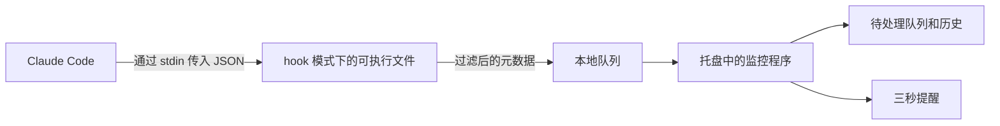

# CodePing

[English](README.md) · [Português](README.pt-BR.md) · [Español](README.es.md) · [Deutsch](README.de.md) · [Français](README.fr.md) · **简体中文**


**当 Claude Code 需要您处理时，显示一条简短提醒。待处理请求会留在队列中，等您方便时回来。**

这是一款适用于 **Windows 10/11 x64** 的本地应用，使用 C# / .NET 10 和 WPF 构建。它会监控本地 Claude Code 会话，包括 VS Code 中的会话，并在出现问题、授权请求、回复完成或错误时提醒您。提醒会进行**三秒**倒计时，不会抢占输入焦点。将鼠标停在提醒上即可继续阅读；倒计时结束后移开鼠标，提醒会立即关闭。

**版本 1.6.0 · 浅色主题 · 六种语言。** 六种语言均使用 CodePing 品牌名称。请参阅[版本历史](CHANGELOG.md)和[已确认的界面布局](design/NAVEGACAO.md)。


*截图来自实际应用的葡萄牙语界面，使用虚构的测试数据。界面支持上方列出的六种语言。*

## 功能

| 功能 | 您可以做什么 |
| --- | --- |
| **多个项目和对话** | 同时监控多个会话，并按项目和对话识别。 |
| **操作与完成提醒** | 接收有关问题、授权、等待批准的计划、输入请求、回复完成和错误的提醒。 |
| **短时提醒，悬停继续阅读** | 查看三秒弹窗而不丢失焦点；将鼠标停在弹窗上即可保持打开。 |
| **声音和弹窗分别控制** | 选择全局提醒渠道，并按模式自定义声音。 |
| **持久保存的队列** | 查看尚待处理的请求，即使重启程序也不会丢失。 |
| **单独推迟** | 将每个请求推迟 5、15 或 30 分钟；在弹窗中可推迟 15 分钟。 |
| **次数有限的重复提醒** | 使用递增间隔、固定间隔或关闭自动重复提醒。 |
| **清晰可见的模式** | 在正常、忙碌和静音之间切换，各模式的选项始终展开。 |
| **恢复与摘要** | 设定恢复正常模式的时间，或使用“我回来了”查看离开期间发生的事情。 |
| **易于识别的名称** | 使用从 Claude 接收的自定义标题，或为每个对话和项目设置本地别名。 |
| **项目独立规则** | 置顶、静音、选择类别和调整提醒，而不影响其他项目。 |
| **本地历史** | 查看已确认的响应、回复完成、错误和会话结束记录，保留 24 小时，最多 500 条活动。 |
| **返回编辑器** | 在 VS Code 中打开项目文件夹，或尝试恢复其已有窗口。 |
| **Windows 托盘** | 让监控程序在后台运行、打开面板、测试提醒或临时静音。 |
| **六种语言** | 即时切换葡萄牙语、英语、西班牙语、德语、法语和简体中文。 |
| **诊断** | 检查集成、可执行文件、队列写入能力和最近一次接收事件的时间。 |
| **本地运行与无障碍操作** | 使用键盘导航、可见焦点和高对比度调整，不向网络服务发送数据。 |
| **品牌与兼容更新** | 使用 CodePing 标志，保留已有设置，并通过打包流程仅保留当前本地发布版本。 |

## 哪些情况会触发提醒

| 情况 | 提醒或行为 |
| --- | --- |
| Claude 请求使用工具的权限 | **需要授权**。 |
| Claude 使用 AskUserQuestion | **Claude 有一个问题**。 |
| Claude 通过 ExitPlanMode 提交计划以等待批准 | **计划等待批准**。 |
| 集成请求回复，包括通过输入/MCP 通知发出的请求 | 收到相应事件时，显示**需要回复**。 |
| Claude 结束一次回复 | **回复已完成**。这并不证明整个任务已经完成。 |
| Claude 发出 StopFailure | **Claude 因错误而停止**。 |
| 会话开始、发送新提示词或使用普通工具 | 更新会话状态；不会为每项活动都显示弹窗。 |
| 会话结束 | 移除该会话的待处理请求，并将结束事件记入历史。 |

提醒受全局偏好设置、当前模式和项目规则控制。CodePing 监控的是 Claude Code 事件；仅有 VS Code 不活跃的情况不会触发提醒。

## 下载与运行

1. 打开[最新版本](https://github.com/victorcqueiroz/CodePing/releases/latest)，下载 `CodePing-1.6.0-win-x64.zip`。
2. 将**所有文件**解压到固定使用的文件夹，然后打开 `CodePing.exe`。
3. 打开**偏好设置 → 启用集成**。如果已经配置过，该操作会显示为**刷新集成**。
4. 在 VS Code 中打开新的 Claude Code 对话，以加载配置。
5. 使用**偏好设置 → 测试提醒**。您可以关闭面板，让程序留在托盘中运行。

安装包包含 .NET 运行时，使用时无需安装 SDK。需要本地 Claude Code，且其命令 hooks 必须支持 `command`、`args` 和 `onFailure`（此集成最初使用 Claude Code 2.1.312 验证）。返回编辑器按钮需要 VS Code。可执行文件没有商业数字签名。

发布版本中的 `SHA256SUMS.txt` 文件可用于核对 ZIP：

```powershell
Get-FileHash .\CodePing-1.6.0-win-x64.zip -Algorithm SHA256
```

请将安装包中的文件保存在一起。hooks 会保存可执行文件的路径；如果移动文件夹，请在新位置刷新集成。

### 提醒与托盘运行

在**偏好设置**中，声音和弹窗可以分别开启或关闭。声音也受当前模式选项控制；静音模式会屏蔽两者。关闭提醒不会中断事件收集，也不会删除待处理请求。

弹窗显示在鼠标指针所在显示器的可用区域右下角，位于其他窗口之上，不会抢占输入焦点。它显示项目、对话、状态和倒计时。使用**打开 VS Code**返回项目；待处理请求还提供**推迟15分钟**操作。提醒的右键菜单可以暂停提醒五分钟。

鼠标停在提醒上时，三秒倒计时仍会继续。如果在阅读期间倒计时结束，提醒会显示**阅读中**并保持打开。倒计时结束后移开鼠标，提醒会立即关闭；如果提前移开，则只等待剩余时间。

关闭或最小化面板会将其收起到托盘，监控程序仍会继续运行。双击图标可重新打开面板。托盘菜单可以打开面板、测试提醒、暂停提醒五分钟、恢复正常模式、停用集成和退出。再次打开可执行文件时，会使用已有实例。

如果集成处于启用状态，在选择**退出**后，下一个 Claude 事件仍可能重新启动监控程序。这并不等于将程序注册为 Windows 登录时自动启动。

## 品牌与兼容性

CodePing 是原 Claude Alert / Claude Alerta 的新名称。标志将代码符号与通知圆点结合；蓝色呼应浅色主题，绿色表示提醒信号。

安装包使用 **CodePing.exe** 作为主可执行文件。`ClaudeAlerta.exe` 是**同一版本** apphost 的副本，用于让已保存旧路径的快捷方式和 hooks 继续工作。两者使用同一监控程序和同一份数据，不会启动两个实例。请刷新集成以使用新名称。

数据仍保存在 `%LOCALAPPDATA%\ClaudeAlerta`，保留偏好设置、语言、模式、别名、待处理请求和历史。在开发机器上，安装文件夹仍为 `release/ClaudeAlerta`；主文件现为 `CodePing.exe`。官方仓库地址为 [victorcqueiroz/CodePing](https://github.com/victorcqueiroz/CodePing)。

品牌文件位于 [Assets](Assets/README.md)：包括可编辑的 SVG、透明背景 PNG 和包含九种尺寸的 ICO。如需在 Windows 上重新生成 PNG 和 ICO，请使用 `scripts/brand-assets.ps1`。

## 侧边导航

面板默认打开**会话**页。左侧的单一菜单提供五个区域入口：

| 区域 | 内容 |
| --- | --- |
| **待处理** | 请求队列、上下文和单独推迟操作。菜单中的数字表示仍等待处理的请求数量。 |
| **会话** | 所有受监控的会话、离开期间的摘要和提醒模式。 |
| **历史** | 最近 24 小时内已确认的响应、回复完成、错误和会话结束记录。 |
| **项目** | 别名、置顶、静音和独立规则。 |
| **偏好设置** | 声音、弹窗、重复提醒、提醒测试和集成诊断。 |

控件具有可见焦点和原生语义，支持键盘导航。窗口较小时，会话和偏好设置页面可垂直滚动。较长的会话列表会限制高度，以确保模式选项始终可访问。

## 待处理：仍需要您处理的事项

每个请求都有独立的一行，显示项目、对话名称和工具（如果可用）。同一会话中的并行问题会分开保留。


- **推迟提醒：** 为所选请求选择 5、15 或 30 分钟。提醒弹窗也提供**推迟15分钟**。
- **在 VS Code 中打开项目：** 尝试恢复对应项目的窗口，或打开其文件夹。不会选择特定对话。

关闭提醒、打开编辑器或推迟提醒，**都不会回复 Claude，也不会解决待处理请求**。收到匹配的确认事件后，请求才会从队列中移除。结束会话也会移除该会话的待处理请求，并记录结束事件。如果无法确定并行工具之间的对应关系，应用会保留待处理请求，避免误将其隐藏。

待处理请求和推迟设置在重启后仍然保留。恢复的状态会显示**已恢复 · 等待新事件确认**，因为最后保存的状态不能证明会话仍然活跃。记录保留 24 小时；历史最多保存 500 条活动。即使会话仍然打开，其中较旧的请求也适用这一期限。

原来的**标记为已读**按钮已被明确的推迟操作取代，避免尚未响应的请求无限期失去提醒。

## 会话：模式与活动

**您的会话**位于页面上方，包含正在处理和等待回复的会话。下方是三个**提醒模式**卡片。点击卡片任意位置即可选择；当前模式会突出显示，并标注**使用中**。

**…模式的提醒**中的选项始终展开，且会随模式选择立即变化。自定义授权/问题、回复完成、错误和声音时，无需打开菜单或展开控件。


| 模式 | 默认行为 |
| --- | --- |
| **正常** | 允许问题、授权、回复完成和错误提醒。 |
| **忙碌** | 允许问题、授权和错误提醒；记录回复完成事件而不显示弹窗，并关闭模式声音。 |
| **静音** | 屏蔽所有弹窗和声音；仍会接收事件并记录活动。 |

在正常和忙碌模式中，您可以选择允许的类别和模式声音。声音还必须在全局偏好设置中开启。静音模式始终屏蔽提醒，即使某个项目设置为允许提醒也一样。

在忙碌或静音模式中，可选择**我回来时**手动恢复，或在 **15 分钟**、**30 分钟**或 **1 小时**后恢复。恢复时间会保存，程序重启后仍然有效。**我回来了**会在会话页恢复正常模式，该页的摘要会显示您离开期间未提醒的回复完成和错误事件。请求仍保留在待处理页。切换忙碌与静音模式会保留这段离开期间；自动恢复不会强制打开面板。

在其他区域中，**模式：…**快捷入口可直接跳转到会话页的模式卡片。**查看历史**可打开详细活动记录。

托盘菜单中的**暂停提醒 5 分钟**会启用静音模式，并在之后自动恢复。双击图标即可打开面板。

### 次数有限的重复提醒

在**偏好设置**中选择全局策略：

- **递增：2、5、15分钟：** 首次重复提醒在 2 分钟后出现，之后分别间隔 5 和 15 分钟。
- **固定间隔：** 30 秒、1 分钟或 2 分钟，保留上一版本的选项。
- **不重复提醒：** 关闭自动重复提醒。

**每个请求最多额外提醒三次**。推迟操作会重置此上限，并按所选时长安排下一次提醒。即使自动重复提醒已关闭，明确推迟仍会安排一次后续提醒。模式、项目规则以及弹窗/声音偏好设置仍然有效。不同请求不会同时弹出重复提醒；监控程序会将这些提醒至少间隔十秒。

回复完成和错误事件在允许时会触发一次初始提醒，不会自动重复。弹窗倒计时仍为三秒。如果倒计时结束时鼠标停在提醒上，提醒会保持可见并显示**阅读中**。之后移开鼠标，提醒会立即关闭。在倒计时结束前移入或移出鼠标，都不会暂停或重置倒计时。


## 识别项目和对话

提醒会突出显示**项目**，在单独一行显示**对话**，并说明状态：回复完成、授权、问题或错误。它会在三秒后自动关闭，同时允许鼠标悬停继续阅读，不会抢占焦点。

名称按以下顺序确定：

1. 在**对话名称**中设置的**本地别名**。
2. 集成收到的 **Claude 自定义标题**。
3. 没有可用名称时使用的**会话短 ID**。

在**会话**中，每一行都提供**对话名称**操作。在**待处理**和**历史**中，同一操作位于右侧详情中。编辑器会显示项目、接收到的标题和完整 ID。您可以保存别名，或将字段留空以恢复使用标题/ID。即使多个对话使用同一文件夹或名称相同，别名也仅属于该会话；它不会重命名 Claude Code 中的对话。

这些名称也会显示在项目列表中。名称最多接受 160 个 Unicode 字符，并会规范为单行。较长名称在界面上会被缩略显示；将鼠标停在列表或提醒中的名称上，可查看完整文本。

标题通过 [SessionStart](https://code.claude.com/docs/en/hooks#sessionstart-input) 和 [UserPromptSubmit](https://code.claude.com/docs/en/hooks#userpromptsubmit-input) 的可选字段 `session_title` 获取。这取决于已安装的 Claude Code 是否提供该字段。您可以在 Claude 中使用 `/rename` 设置自定义名称；集成会在后续兼容事件中接收它。**自动生成的标题不会出现在此字段中。** 应用不会读取对话或对话记录来尝试查找标题。不含标题的事件会保留上次收到的标题；明确为空的标题则会清除它。

收到的标题会保存在状态和活动中，包括会话结束之后，仍遵循 24 小时保留期限。手动选择的别名会保留在偏好设置中，直到被移除。旧版本文件可继续使用，无需手动迁移。**打开 VS Code**仍然只会打开项目，不会选择特定对话。

## 项目：独立规则


项目会在收到其事件时出现。您可以：

- 设置仅在面板和提醒中显示的别名，不重命名文件夹；
- 将常用项目置顶；
- 将某个项目静音，而不影响其他项目；
- 允许或屏蔽授权/问题、回复完成和错误；
- 使用全局提醒间隔，或为该项目选择其他间隔；
- 查看对话名称和已知的会话状态。

项目规则会**进一步限制**当前模式：提醒必须同时获得两者允许。比较文件夹时不区分大小写，也不受末尾斜杠影响。不同文件夹中的同名项目仍被视为不同项目。

## 检查集成

在**偏好设置**中，**检查集成**会检查可执行文件、用户配置中是否存在预期的处理程序，以及本地队列是否可写。同一区域还会单独显示**最近事件**的接收日期和时间。

配置有效并不能证明新事件已经送达。只有收到真实的 Claude 事件，才能确认完整流程。没有事件不会被视为卡住或断开连接；较长的回复可能在一段时间内不产生事件。策略、项目配置和 `disableAllHooks` 都可能影响 hooks 的执行。

## 语言

右下角的简洁选择器提供 **Português、English、Español、Deutsch、Français 和 简体中文**。切换立即生效，覆盖所有导航、卡片、模式选项、提醒和托盘菜单，并会保存到下次启动。更改语言不会改变待处理请求的状态，也不会重置当前打开提醒的倒计时。

默认语言为葡萄牙语。版本 1.2.0 的偏好设置会保留语言、声音、弹窗和提醒间隔。全新安装默认使用递增提醒。语言目录嵌入程序，不使用网络翻译。

## 本地数据与隐私

程序使用 [Claude Code 官方 hooks](https://code.claude.com/docs/en/hooks)。它不会尝试解析屏幕图像，也不会根据 CPU 使用量推断活动。



同一可执行文件会在 hook 模式下快速接收事件，并运行监控程序，每 500 ms 检查一次队列。临时事件在处理并保存后删除；超过十分钟的事件会被丢弃。近期相同事件会被去重，重启后也一样。

在 `%LOCALAPPDATA%\ClaudeAlerta` 中：

| 文件/文件夹 | 内容 |
| --- | --- |
| `preferences.json` | 语言、声音、弹窗、模式、恢复时间、项目/对话别名和项目规则。 |
| `activity.json` | 会话、自定义标题、请求、推迟设置、工具 ID、历史和最近事件时间。 |
| `inbox/` | 事件的临时元数据。 |

程序仅保存会话/工具 ID、项目文件夹、事件/工具名称、通知类型、收到的自定义标题和时间，以及派生状态和所选偏好设置。**提示词、回复、命令、文件内容、通知消息和对话记录都会在写入前丢弃。** 应用不会截取屏幕、批准操作或发起网络请求。测试截图仅渲染应用自身的窗口。

写入采用原子文件替换。如果某个文件无法恢复，面板会提示问题；在替换该文件之前，会保留一份 `*.invalid-*.bak` 副本。这些恢复备份不受 24 小时自动过期规则影响。如果活动写入失败，事件会留在队列中等待重试，面板会显示失败信息。

集成会修改 `~/.claude/settings.json`，保留其他设置和 hooks，并在修改前创建 `settings.json.claude-alerta-*.bak` 副本。要停用集成，请先在托盘中选择**停用集成**，然后选择**退出**。如果仅退出，下一个事件仍可重新启动监控程序。

## 可用命令

在解压后的应用文件夹中运行：

| 命令 | 操作 |
| --- | --- |
| `.\CodePing.exe` | 打开面板，或请求打开已有实例。 |
| `.\CodePing.exe --tray` | 启动监控程序并收起到托盘。 |
| `.\CodePing.exe --install-hooks` | 安装或刷新集成，保留其他设置；如果文件已存在则创建备份。 |
| `.\CodePing.exe --remove-hooks` | 仅移除属于此应用的处理程序。 |
| `.\CodePing.exe --shutdown` | 请求退出正在运行的监控程序。 |

测试脚本使用具有独立存储的诊断模式；监控 Claude Code 时无需使用这些模式。

## 限制

- 监控当前 Windows 账户的**本地**会话，包括终端中的会话；并非仅适用于 VS Code 扩展。
- WSL、SSH、容器和云会话需要额外的桥接机制，本项目未实现。不会监控 Codex。
- `Stop` 表示一次回复结束，并不表示整个任务完成。`idle_prompt` 是空闲提醒，并不能证明处理已卡住。
- `PermissionRequest` 不提供 `tool_use_id`。如果无法安全关联并行权限请求，该请求会保持待处理状态，直到收到明确确认、会话结束或记录过期。
- 丢失或乱序的事件可能导致状态无法确认。请在 Claude 中核实对话；监控程序不会替您做决定。
- 返回 VS Code 时无法定位到确切对话。独占全屏游戏可能遮挡提醒。
- 同一时间只显示一个弹窗；新提醒可能替换旧提醒，包括鼠标悬停阅读期间。请求仍保留在队列中，回复完成/错误事件仍保留在历史中。
- 清理只在监控程序运行时或再次启动时进行；应用退出后没有后台清理服务。

## 构建、测试与打包

需要 [.NET 10 SDK](https://dotnet.microsoft.com/download/dotnet/10.0)、Windows x64 和 PowerShell 7：

```powershell
git clone https://github.com/victorcqueiroz/CodePing.git
cd CodePing
.\scripts\build.ps1
.\scripts\test.ps1 -SkipBuild -Ui
.\scripts\package.ps1 -SkipBuild
```

发布输出位于 `artifacts/publish/win-x64/`；ZIP 和其 SHA-256 位于 `artifacts/releases/1.6.0/`。如需使用其他本地 SDK，请向构建、测试或打包脚本传入 `-Dotnet C:\caminho\dotnet.exe`。

### 仅保留最新本地发布版本

打包流程只在 `artifacts/releases/` 中保留当前版本的安装包。只有在新安装包及其 SHA-256 已生成并核对后，才会删除旧版本 ZIP。包含更新版本或无法识别内容的文件夹会被保留。

如需同时清理已有工作文件夹中 `release/` 和 `artifacts/` 下的旧分发文件：

```powershell
.\scripts\clean-releases.ps1 -LegacyRoot 'C:\caminho\da\pasta-de-trabalho' -WhatIf
.\scripts\clean-releases.ps1 -LegacyRoot 'C:\caminho\da\pasta-de-trabalho'
```

清理要求当前安装包有效。它只删除被识别为 CodePing 或 Claude Alert 的旧文件夹，会核实路径并拒绝链接/目录联接。不带版本后缀的安装目录 `release/ClaudeAlerta`、个人数据、其他项目和 GitHub 历史均会保留。本地更新应替换唯一的安装文件夹，并在验证后丢弃旧二进制文件，不保留旧发布版本的备份。

构建后，运行 `scripts/test-cleanup.ps1`，在独立文件夹中测试保留规则，包括其他项目的保留和与打包流程的集成。

如需仅通过 SDK 构建可执行文件：

```powershell
dotnet publish .\ClaudeAlerta.csproj -c Release -r win-x64 --self-contained true -o .\artifacts\publish\win-x64
```

测试使用 `artifacts/tests/` 中的独立存储，保留 Claude 的个人配置。`-Ui` 要求 Windows 会话具有可用桌面，可能会短暂显示窗口。测试结果、证据和限制见 [VALIDACAO.md](VALIDACAO.md)。

准备分发版本时，优先使用 `scripts/build.ps1`：它会创建干净的发布输出，包含文档和品牌文件，并生成兼容 apphost `ClaudeAlerta.exe`。直接调用 SDK 不会执行这些额外步骤。仅修改文档无需发布新版本的可执行文件，也无需替换已发布版本的校验和。

## 其他语言的文档

六份 README 覆盖相同的功能、说明和限制。请使用顶部的语言链接。所链接的版本历史、验证报告、品牌指南和设计文档仍为葡萄牙语。

## 项目结构

```text
Program.cs               初始化、托盘和 hooks 入口
Core.cs                  存储、过滤和 hooks 安装
MonitorModel.cs          独立请求、历史和持久化
Preferences.cs           模式、项目规则和提醒策略
Dashboard.xaml/.cs       侧边导航、会话、模式和诊断
AlertCard.xaml(.cs)       三秒提醒和鼠标悬停阅读
ConversationEditor.*     对话本地别名编辑器
ConversationNames.cs     名称规范化和长度限制
ClaroTheme.xaml          浅色主题和共享样式
Assets/                  SVG/XAML 标志、PNG、ICO 和品牌指南
Localization.cs          语言应用和回退
Locales/                 六份内嵌语言目录
SelfTest.cs / UiCheck.cs  监控程序和界面的独立测试
scripts/                 构建、测试和版本化安装包
docs/images/             演示截图
```

项目未声明任何第三方包。标志是项目自有资源；其余字形和字体使用 Windows 系统资源。
